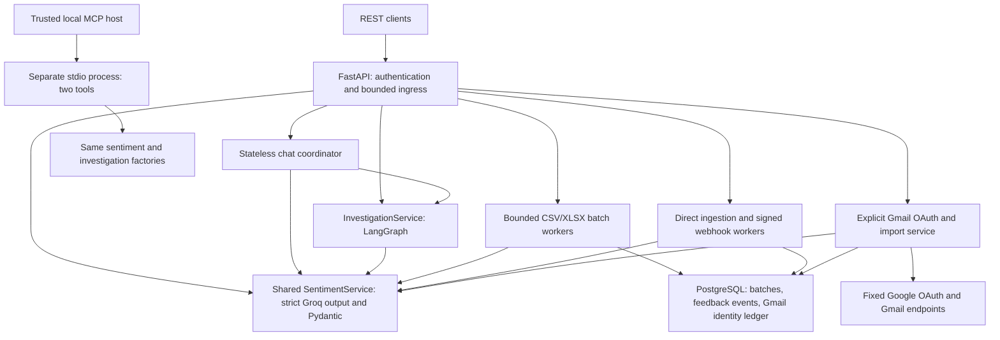
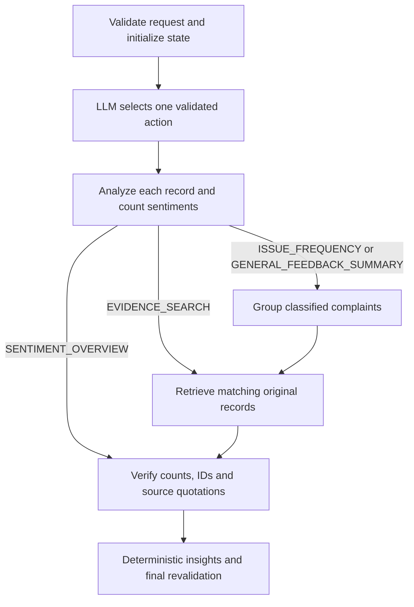

# Agentic AI Sentiment Analysis & Customer Feedback Intelligence API

An API-only Python backend that turns customer feedback into sentiment, aspects,
issue categories, tentative urgency and review suggestions. Businesses can compare
complaints across submitted reviews, investigate source records, upload CSV/XLSX,
accept signed feedback events and explicitly import labelled incoming Gmail mail.
Python computes counts and reports; an LLM does not invent operational metrics.

**Academic scope:** a bounded, tool-using agentic workflow, not a fully autonomous
agent. There is no frontend, conversation memory, autonomous mailbox polling,
external business action or general-purpose execution tool. Deployment is not an
inferred reviewer requirement. The independently verified original reviewer rubric
is unavailable; requirements compliance is therefore provisional.

**Current verification:** see [final submission audit](docs/qa/FINAL_SUBMISSION_AUDIT.md)
for the fresh test count, findings and demo. Automated providers are mocked;
PostgreSQL tests use a real isolated server. The historical single live Groq smoke
is recorded [here](docs/qa/LIVE_GROQ_VERIFICATION_REPORT.md). The user additionally
reports live Google OAuth, incoming-email/Groq analyses, incremental/partial imports,
failed-message retries and restart deduplication, including six prior successes
recognized after restart. These manual observations were not repeated by the audit.
Live deterministic sanitization and **real external MCP host integration remain
unverified**. Large-mailbox and sent-filter edge cases have automated evidence,
not a claim of equivalent live testing. This is not production certification.

## What is agentic here?

- **Sentiment analysis:** ordinary schema-constrained LLM classification of one text.
- **Investigation:** LangGraph runs a multi-step workflow. A strict LLM selector
  maps the user's question to four allowlisted actions. Deterministic edges choose
  overview, evidence-search or issue-grouping paths; tools analyze, count, filter,
  retrieve original records and verify results before rendering an answer.
- **MCP:** two local stdio tools expose those same service implementations to a
  compatible client. MCP is an interface, not itself the source of agency.

The selector sees only question/business hint, never feedback or tool observations.
It runs once; intermediate observations inform findings, not iterative replanning.
There are meaningful conditional paths and bounded multi-step execution, but no
self-directed goals, persistent memory or autonomous tool-discovery loop.
The required [awesome-agentic-patterns catalogue](https://github.com/nibzard/awesome-agentic-patterns)
informs the implementation; [pattern mappings](docs/AGENTIC_PATTERNS.md) distinguish
implemented mechanisms from partial adaptations.

## Architecture



MCP and REST share implementation, not process memory or budgets. Within REST,
classification, selector, chat, batches, webhook and Gmail consumers share bounded
model admission. Sync parsing/SQL work is offloaded. PostgreSQL enforces one
application coordinator; run **one Uvicorn worker**.



| Directory | Responsibility |
| --- | --- |
| app/api/v1 | Thin REST adapters and permission declarations |
| app/schemas | Pydantic request/output contracts |
| app/services | Shared analysis, investigation, chat, parsing, jobs and integration logic |
| app/agents, app/tools, app/prompts | Graph/state/selector, deterministic tools and isolated prompts |
| app/integrations | Fixed Google HTTP adapter and bounded MIME extraction |
| app/storage | PostgreSQL repositories/models plus explicitly injected test adapters |
| app/mcp_server | Official MCP SDK stdio entry point and exactly two tools |
| migrations, tests, docs | Alembic revisions, offline regressions and operating guides |

## Stack and prerequisites

Python **3.12.16**, uv **0.13.6**, FastAPI/Uvicorn, Pydantic v2, langchain-groq,
Groq, LangGraph, official **mcp==2.3.0**, HTTPX, SQLAlchemy 2, Alembic, psycopg 3,
openpyxl and Pandas. pyproject.toml declares constraints; uv.lock pins resolved
versions/hashes. The full LangChain umbrella, Redis, Celery and SQLite are absent.

Use a writable POSIX/Linux project directory, a non-root account, HTTPS access for
initial tool/package downloads and PostgreSQL server/client binaries. Do not change
system Python. A supported PostgreSQL release is recommended; the actually tested
local server is **12.22, end-of-life**, so supported-version/production acceptance
remains outstanding. Do not modify an unrelated system PostgreSQL cluster.

For academic ZIP delivery, extract the archive and enter its single
agentic-sentiment-intelligence/ folder. Git is not needed to install, run or submit
this copy. Follow [the ZIP handoff guide](docs/SUBMISSION_ZIP.md), then the setup
below. The archive includes uv.lock and all migrations, but no private .env,
installed tools/environment or runtime database; create your own configuration
and database. The managed workspace's empty read-only .git mount prevents Git
tracking/history verification, not ZIP delivery. Historical source archives
predating T09 are not the current source.

## Install the isolated environment

From the project directory, download and **review the entire official installer
before executing it** on a fresh machine:

```bash
curl -fLsS https://astral.sh/uv/0.13.6/install.sh -o /tmp/sentiment-uv-install.sh
cat /tmp/sentiment-uv-install.sh
# After reviewing it:
UV_UNMANAGED_INSTALL="$PWD/.tools/bin" sh /tmp/sentiment-uv-install.sh
```

Use these exports in each development shell:

```bash
export PATH="$PWD/.tools/bin:$PATH"
export UV_PYTHON_INSTALL_DIR="$PWD/.tools/python"
export UV_PYTHON_BIN_DIR="$PWD/.tools/bin"
export UV_CACHE_DIR="$PWD/.cache/uv"
export UV_PYTHON_CACHE_DIR="$PWD/.cache/uv-python"
export UV_PROJECT_ENVIRONMENT="$PWD/.venv"
uv python install 3.12.16
uv sync --locked
uv pip check --python .venv/bin/python
```

Use --offline only when the pinned interpreter and package artifacts are cached.
The audit reproduces a fresh source-copy environment from that cache; a new online
clone/install on another machine was not claimed. Virtual environments and local
managed interpreter paths are not portable submission artifacts.

On a **fresh copy only**, create private configuration:

```bash
cp .env.example .env
chmod 600 .env
```

Do not overwrite an existing private .env. Set GROQ_API_KEY privately for inference,
APP_API_KEY to a privately generated development secret and DATABASE_URL as below.
The copied database URL is a placeholder until replaced. Environment variables
precede the optional project-root .env; configuration changes require restart.
Never commit credentials or copy private runtime files into a submission.

## PostgreSQL setup and startup

For an existing database, set its private postgresql+psycopg URL, migrate, and skip
initialization below. Missing DB config leaves stateless features available but
batch/direct/webhook/Gmail-import work unavailable. A configured unreachable,
unmigrated or already-coordinated database fails startup safely.

For a **new isolated local demo cluster only**, choose a PostgreSQL installation
via PG_BIN. Never initialize over existing data. These commands use a private
0700 Unix-socket directory and no TCP listener; local trust is for this single-user
demo, not production. Use a project path without spaces for this shell example.

```bash
export PG_BIN="$(pg_config --bindir)"
mkdir -p .local/postgres-demo .local/postgres-demo-socket
chmod 700 .local/postgres-demo .local/postgres-demo-socket
"$PG_BIN/initdb" -D "$PWD/.local/postgres-demo" --auth-local=trust \
  --auth-host=reject --username=sentiment_owner --no-locale --encoding=UTF8
"$PG_BIN/pg_ctl" -D "$PWD/.local/postgres-demo" \
  -l "$PWD/.local/postgres-demo/server.log" \
  -o "-k $PWD/.local/postgres-demo-socket -c listen_addresses=''" -w start
"$PG_BIN/psql" -h "$PWD/.local/postgres-demo-socket" -U sentiment_owner -d postgres \
  -v ON_ERROR_STOP=1 -c 'CREATE ROLE sentiment_app LOGIN NOSUPERUSER NOCREATEDB NOCREATEROLE'
"$PG_BIN/createdb" -h "$PWD/.local/postgres-demo-socket" -U sentiment_owner \
  -O sentiment_app agentic_sentiment_dev
"$PG_BIN/createdb" -h "$PWD/.local/postgres-demo-socket" -U sentiment_owner \
  -O sentiment_app agentic_sentiment_test
export DATABASE_URL="postgresql+psycopg://sentiment_app@/agentic_sentiment_dev?host=$PWD/.local/postgres-demo-socket"
uv run --locked alembic upgrade head
uv run --locked uvicorn app.main:app --host 127.0.0.1 --port 8000 --no-access-log
```

On later runs, reuse the cluster and apply upgrade head; do not repeat initdb/role
creation. The current chain is t09_batch_v1 → t09_batch_v2 → feedback_results_v1 →
**gmail_incremental_v1**. The application never creates tables implicitly.
See [database lifecycle/backups](docs/POSTGRESQL_BATCH_STORAGE.md) for existing
prepared-cluster commands and passworded-server alternatives.

Open http://127.0.0.1:8000/docs, /redoc or /openapi.json in development.
GET /health returns {"status":"ok"}: process liveness, not database/provider readiness.
Production hides docs by default; API_DOCS_ENABLED can explicitly override it.
Avoid --reload during restart/persistence demos; never use --workers 2.

## Authentication, security and limits

REST uses X-API-Key with a server-side business registry. TENANT_CREDENTIALS_JSON
entries contain tenant_id, key_id, a private URL-safe secret generated from at least
32 random bytes, and optional permissions. Missing identity is 401, missing permission
403, foreign/unknown owned resources 404. Tenant authority never comes from payload
business_type, IDs or model output. Rotation keys share tenant ownership/quotas.

Development-only APP_API_KEY owns the fixed development tenant. APP_ENV=production
always ignores legacy app/webhook keys and requires the business/integration registry.
With a business registry in nonproduction, legacy access requires explicit
DEVELOPMENT_AUTH_ENABLED=true. [Registry format and permissions](docs/TENANT_ISOLATION.md).

| Limits/settings | Default |
| --- | --- |
| GROQ_MODEL / GROQ_TIMEOUT_SECONDS / GROQ_MAX_RETRIES | openai/gpt-oss-20b / 30 seconds / 2 provider retries |
| INVESTIGATION_TIMEOUT_SECONDS | 120 seconds; at most 10 sequential records; recursion limit 12 |
| JSON_MAX_BODY_BYTES / WEBHOOK_MAX_BODY_BYTES | 4,194,304 / 16,384 actual incoming bytes |
| Ingress active / rolling-minute / body deadline | 16 / 120 / 15 seconds |
| MODEL_MAX_CONCURRENT_CALLS | 4 shared REST logical classifier/selector operations |
| Batch file / records / active / retained / model permits | 2 MiB / 100 / 3 / 20 / 2 |
| Business retained batches / events | 5 / 20, with global headroom |
| Webhook workers / pending / retained / deadline | 2 / 20 / 100 / 60 seconds |
| BATCH_JOB_TTL_SECONDS / INGESTION_RESULT_TTL_SECONDS | 0 = indefinite terminal retention; positive explicitly enables expiry |
| Gmail new messages / pages / deadline | 20 / 5 / 120 seconds |
| Gmail global/tenant active imports / retained jobs | 2/1 / 20 global and 5 tenant |
| Gmail job retention / connection hard TTL | 30 minutes / 8 hours, in memory |
| Gmail tracking global/tenant / logical attempts / cooldown | 10,000/1,000 / 3 / 60 seconds |
| Gmail HTTP active / total deadline / transient retries | 4 / 10 seconds / 1 |
| MCP_MAX_CONCURRENT_CALLS | 2 per separate local process |

Tenant-specific quotas preserve headroom; see .env.example and Settings for all
ranges. Capacity exhaustion rejects work; active/history records are not silently
evicted. Indefinite retention can fill finite quotas. Configure an explicit policy.
The 4 MiB JSON cap is an approved intentional API change; signed raw bytes are
preserved. Multipart retains a separate file limit and 64 KiB envelope allowance.

Inputs, emails, files and tool results are untrusted. Action allowlists, closed
schemas, original-byte HMAC, PKCE/state, exact-quote checks and safe error/logging
bound their effects; they do not prove classification accuracy or injection immunity.
SQL filtering enforces application-level tenant ownership, not PostgreSQL row-level
security. Store/proxy/database logs and backups need independent private handling.

## REST reference

| Method/path | Authority / result |
| --- | --- |
| GET /health | Public liveness |
| POST /api/v1/sentiment/analyze | sentiment:analyze; complete SentimentResponse |
| POST /api/v1/agent/investigate | feedback:investigate; bounded graph response |
| POST /api/v1/chat | chat:analyze; explicit stateless mode |
| POST /api/v1/batch/upload | batch:create; multipart CSV/XLSX; 202 job ID |
| GET /api/v1/batch/jobs/{job_id} | batch:read; progress |
| GET /api/v1/batch/jobs/{job_id}/results | batch:read; page/page_size, settled results |
| GET /api/v1/batch/jobs/{job_id}/report | batch:read; 202 while active, otherwise report |
| GET /api/v1/batch/jobs/{job_id}/download | batch:read; 202 while active, otherwise JSON attachment |
| POST /api/v1/ingest/feedback | feedback:ingest; synchronous persisted analysis |
| GET /api/v1/ingest/events/{delivery_id} | events:read; status only |
| GET /api/v1/ingest/events/{delivery_id}/result | events:read; 202 pending, 200 terminal original feedback/result |
| POST /api/v1/webhooks/feedback | HMAC; 202 accepted, 200 authenticated duplicate |
| POST /api/v1/integrations/gmail/connect | gmail:connect; private authorization URL |
| GET /api/v1/integrations/gmail/oauth/callback | Expiring single-use state; not X-API-Key |
| GET /api/v1/integrations/gmail/status | gmail:read; connection status |
| DELETE /api/v1/integrations/gmail/disconnect | gmail:connect; local disconnect |
| POST /api/v1/integrations/gmail/import | gmail:import; 202 job ID |
| GET /api/v1/integrations/gmail/imports/{job_id} | gmail:read; owner job/counters |
| GET /api/v1/integrations/gmail/imports/{job_id}/results | gmail:read; owner message outcomes |

Success results may contain sensitive summaries/quotes. Errors use error.code,
error.message and request_id; validation details omit input values and untrusted
field names. Common statuses: 422 invalid input, 413 oversized body/file, 429 quota,
502 provider/invalid output, 503 missing configuration/storage, 504 model deadline.
Webhook signature failures are 401; authenticated conflicts are 409. /health makes
no provider call. Use the live OpenAPI for complete response/error schemas.

## Analysis, correction and reduced evidence

For intentional live usage only, configure credentials privately; this sends text
to Groq. An illustrative request (no predetermined response is promised):

```bash
curl -X POST http://127.0.0.1:8000/api/v1/sentiment/analyze \
  -H "X-API-Key: $APP_API_KEY" -H 'Content-Type: application/json' \
  --data '{"text":"The product is excellent, but delivery was very late.","source":"manual","business_type":"ecommerce"}'
```

Output fields: sentiment, issue_category, urgency, aspects, summary,
suggested_next_step and evidence_phrases. Sentiment has POSITIVE/NEGATIVE/NEUTRAL/MIXED;
urgency has LOW/MEDIUM/HIGH/CRITICAL. Categories and business/source allowlists are
in [the schema](app/schemas/sentiment.py). Urgency is tentative triage, not a calibrated
risk score. Summary/recommendation are model interpretations, not completed actions.

Native json_schema strict=True remains mandatory. Provider retries share one total
deadline. An otherwise-valid grounding failure gets one fixed-instruction correction
call, with no separate provider retry loop. If correction still fails ONLY exact
grounding, deterministic filtering drops nonexact phrases, changes no other fields
and revalidates the complete response with original text. Other schema/parser/type/
provider failures still reject. Maximum invocations per logical analysis are
GROQ_MAX_RETRIES+2, default four; valid first output uses one. Sanitization adds none.

Every retained phrase is an exact contiguous case-sensitive substring. **An empty
list is valid but supplies no retained model quotation or independent substantiation
of the classification/summary.** Sanitization cannot fix hallucinated interpretations.
Safe logs distinguish rejection, successful model correction and sanitization with
bounded counts; they never include feedback, quote values or raw exceptions.
[Evidence policy and tests](docs/qa/EVIDENCE_SANITIZATION_REPORT.md).

## Investigation and stateless chat examples

POST /api/v1/agent/investigate with the owning key and this JSON:

```json
{
  "question": "Which complaints are most frequent?",
  "business_type": "ecommerce",
  "feedback": [
    {"id": "R1", "text": "Delivery was very late."},
    {"id": "R2", "text": "Excellent product quality."}
  ]
}
```

The selected_action, tools_used, counts, source evidence and limitations expose what
actually ran. Try “Show the overall sentiment distribution” (overview), “Which
negative feedback mentions delivery?” (evidence search), and the question above
(issue aggregation). These exercise three source-supported paths; actual LLM
selection is not guaranteed solely by example wording. No final prose model call.
At most 11 logical model operations for ten records; with default provider retries
and possible correction, at most 41 invocations (51 with three retries), further
bounded by the overall investigation deadline. Any unrecovered record failure aborts.

POST /api/v1/chat requires an explicit mode and current-request data:

```json
{"mode":"ANALYZE_TEXT","message":"Analyze this feedback.","feedback_text":"Delivery was late."}
```

For INVESTIGATE_FEEDBACK, supply message as the investigation question and feedback
as the same bounded record array. Exactly one result is populated. Message is not
classified as feedback in ANALYZE_TEXT. No history, session, remembered identity,
automatic intent detection or durable conversation memory exists.

## CSV/XLSX batches and persistence

The checked-in sample has id, review and date columns:

```bash
curl -X POST http://127.0.0.1:8000/api/v1/batch/upload \
  -H "X-API-Key: $APP_API_KEY" \
  -F 'file=@docs/examples/t09_reviews.csv;type=text/csv' \
  -F 'text_column=review' -F 'id_column=id' -F 'date_column=date'
```

Use an equivalent .xlsx file with the first worksheet; no .xls/.xlsm support.
UTF-8 CSV and bounded XLSX ZIP/XML are validated; formulas/attachments/macros are
not executed. Invalid text rows fail without inference; invalid optional dates do
not invent dates. Source defaults file_upload metadata; T01 receives source=manual.
An explicit blank source is rejected rather than silently defaulted.

Save job_id. Poll /batch/jobs/{job_id}, retrieve /results?page=1&page_size=25,
/report and /download under /api/v1. Workers process sequential rows with shared
permits; ordinary per-row failures allow PARTIAL_SUCCESS, fatal configuration/auth
errors stop further calls. Report arithmetic is deterministic; percentages use
successful records only. Empty model evidence produces no fabricated report excerpt.

| Data | Persistence / restart behavior |
| --- | --- |
| Batch jobs, outcomes, report inputs | PostgreSQL; terminal retention indefinite by default; recover unfinished eligible rows with fenced leases |
| Pending batch raw text | PostgreSQL until outcome commits, then cleared |
| Direct/webhook original feedback and analysis | PostgreSQL; indefinite by default, optional explicit TTL |
| Webhook duplicate identities/digests | PostgreSQL; authenticated identical retries never repeat inference; unfinished startup events fail INGESTION_INTERRUPTED |
| Gmail tenant + verified mailbox hash + message ID and attempts/claims | PostgreSQL; successes retained through restart/disconnect/job expiry, within finite quotas |
| Gmail OAuth/state/tokens/mailbox reservations/jobs/results | Private process memory; reconnect after restart; historical results can return 404 |
| Chat/graph invocation state; local MCP transcripts | No application persistence or durable memory |

Only batch work is automatically recovered for further processing. Interrupted
ingestion is terminalized without automatic replay; Gmail imports require explicit
API calls. Lost precommit external responses may repeat: no exactly-once guarantee.
Protect derived quotes, stored originals, database access and backups. No public
administrative deletion/reset API is included.

## Direct ingestion and signed webhooks

POST /api/v1/ingest/feedback accepts text, channel (website/mobile_app/
support_platform/external_api), optional feedback_id, source and business_type.
It persists before inference and returns X-Feedback-Delivery-Id and relative Location
for later result reads, including controlled failures after reservation. Repeating
this POST creates another event; it has no caller-idempotency contract.

For webhooks configure a private integration ID/secret bound to a registry tenant.
Send the exact JSON bytes with HMAC-SHA256 over:

```text
integration_id.timestamp.delivery_id.raw_body
```

The final dot precedes the original raw body bytes, not a reserialized object.
This executable local sender uses existing private shell variables and synthetic
feedback. Run only for intentional live inference against your configured app:

```python
import hashlib, hmac, json, os, time
import httpx
raw = json.dumps({"event_type":"customer.feedback.created",
                  "feedback":{"id":"demo-review","text":"Delivery was late."}},
                 separators=(",", ":")).encode()
integration = os.environ["WEBHOOK_INTEGRATION_ID"]
secret = os.environ["WEBHOOK_SHARED_SECRET"]
stamp, delivery = str(int(time.time())), "demo-delivery-001"
canonical = f"{integration}.{stamp}.{delivery}.".encode() + raw
headers = {"Content-Type":"application/json", "X-Feedback-Integration-Id":integration,
           "X-Feedback-Timestamp":stamp, "X-Feedback-Delivery-Id":delivery,
           "X-Feedback-Signature":"sha256=" + hmac.new(secret.encode(), canonical, hashlib.sha256).hexdigest()}
response = httpx.post("http://127.0.0.1:8000/api/v1/webhooks/feedback", content=raw, headers=headers, timeout=20)
print(response.status_code)  # Do not print secrets, headers or customer payloads.
```

In production use values from the configured WEBHOOK_INTEGRATIONS_JSON entry,
not the disabled legacy development fallback. Timestamps accept ±300 seconds by
default, and every retry authenticates again. Same tenant/delivery/integration/body
returns 200 DUPLICATE; different exact bytes or another integration colliding with
that ID returns 409. 202 means admission, not completed inference. Retrieve owner
status/result using the two event GETs. [Full contract](docs/WEBHOOK_INTEGRATION.md).

## Gmail workflow

1. Configure Google Cloud's Gmail API/OAuth client and readonly consent, private
   GOOGLE_OAUTH_CLIENT_ID/SECRET, exact GOOGLE_OAUTH_REDIRECT_URI and GMAIL_OAUTH_ENABLED=true.
   Default is disabled. gmail.readonly is the only requested/accepted scope. Local
   HTTP callback needs GMAIL_ALLOW_LOCALHOST_HTTP=true outside production only.
2. POST /api/v1/integrations/gmail/connect with gmail:connect authority; open its
   private authorization_url and complete Google OAuth. Callback accepts legitimate
   iss/scope parameters, validates Google's issuer when supplied, single-use tenant
   state and S256 PKCE; token-response scope remains authoritative.
3. GET /status must show CONNECTED. In Gmail label recent incoming plain-text
   feedback customer-feedback (or the configured label). Archived mail is allowed;
   SENT, Spam/Trash and attachment-bearing mail are not analyzed.
4. POST /import with {"max_messages":3}; poll /imports/{job_id}, then /results under
   the same Gmail prefix. max_messages is an upper bound: two available can finish
   with two; genuinely exhausted mail can finish with zero.
5. Repeated imports skip durable successes before selection. Failed messages retry
   only through a new import after cooldown while attempts remain. Sanitized empty-
   evidence success is also a durable success; it is not retried just for more quotes.
6. Restart requires reconnecting the same tenant/mailbox. Successful identities
   remain skipped, but old Gmail job URLs/results do not become a durable archive.

Selection uses labelIds, newer_than:Nd -in:sent and includeSpamTrash=false. A bounded
minimal label-only fetch rechecks SENT before claiming; MIME preflight/body validation
recheck labels before inference. Sender address is not an outgoing-mail heuristic.
A label change after selection produces the existing selection-invalid skip, no Groq
call. Bodies are bounded to 16 KiB/5000 characters by default. Subject/sender/time and
OAuth secrets are not sent for sentiment; selected text is sent to Groq.

| New status field | Meaning |
| --- | --- |
| scanned_messages | Returned ID rows including repeats/unselected page tails; query-excluded IDs are not seen |
| previously_processed_messages | Distinct durable successes filtered during selection |
| deferred_messages | Distinct busy/cooldown/attempt-exhausted IDs filtered before admission |
| scan_exhausted | Listing ended before reaching the requested new count; not proof every email succeeded |
| scan_limit_reached | More pages exist but configured page budget ended |
| capacity_limit_reached | Tracking quota prevented an unseen identity from being admitted |

Scans restart at the beginning and use no permanent page cursor. Page limits may
hide new mail behind a long processed prefix; flags distinguish this from exhaustion.
The metadata ledger is pseudonymous, not anonymous; it stores no email body/token.
A deliberate 1000-message profile sets GMAIL_MAX_MESSAGES_PER_IMPORT=100,
GMAIL_MAX_LIST_PAGES=10, GMAIL_TENANT_MAX_RETAINED_IMPORTS=12 and
GMAIL_IMPORT_TIMEOUT_SECONDS=600, with tracking capacities 10000/1000. Tests exercise
ten batches of 100 plus zero, and 250 as 100/100/50/0, using mocks, not live Google.
[Exact profile/Postman guide](docs/GMAIL_INCREMENTAL_IMPORTS.md),
[OAuth/MIME/privacy guide](docs/GMAIL_INTEGRATION.md).

## Local MCP and pending external-host check

Launch from the project root:

```bash
.venv/bin/python -B -m app.mcp_server.server
```

Exactly analyze_feedback and investigate_feedback expose the existing sentiment
and investigation services, with typed input/output schemas. No API-key/tenant_id
argument, owned lookup, report/Gmail/database/shell tool, HTTP listener, resource
or prompt capability is exposed. Launcher authority is trusted; local MCP does
not implement REST business authentication. It creates no PostgreSQL job store.
Stdout is protocol-only; fixed diagnostics use stderr. Each process has its own
limits and provider-account access.

Official SDK in-process (legacy/auto) and subprocess stdio tests verify discovery,
invocation, schemas, safe errors, capacity and clean shutdown. These **do not complete
real external-client acceptance**. Use the [exact external-host steps](docs/MCP_INTEGRATION.md#real-external-client-acceptance-still-pending)
with a compatible installed client; do not publish launcher secrets. A no-key
configuration can safely verify discovery and controlled GROQ_NOT_CONFIGURED.
Successful live tool calls require separate owner-configured provider access.

## Automated tests and demonstration

With the isolated local test database above running:

```bash
export T09_TEST_DATABASE_URL="postgresql+psycopg://sentiment_app@/agentic_sentiment_test?host=$PWD/.local/postgres-demo-socket"
GROQ_API_KEY='' APP_API_KEY='' uv run --locked --offline pytest -q
GROQ_API_KEY='' APP_API_KEY='' uv run --locked --offline pytest -q -m protocol
uv pip check --python .venv/bin/python
```

No live provider credentials are needed. The fixture requires a dedicated *_test
DB, migrates a random schema per PostgreSQL case and drops only that schema. A
missing URL skips DB cases and is not equivalent to the complete reported run.
Tests exercise failure, cancellation, auth/ownership, concurrency, restart and
strict adapters through mocked HTTP; they are not a model-accuracy benchmark.
Coverage/lint/vulnerability scanners are not silently claimed when unavailable.

For an academic demo: explain the architecture and qualified agentic claim; run
sentiment; compare three investigation paths; show both chat modes; upload the
sample batch and retrieve reports after restart; sign a synthetic webhook and
show duplicate/result behavior; show Gmail incremental/partial imports; explain
MCP protocol evidence and the pending external-host check. Actual commands,
findings, three graph traces and evaluator Q&A are in the
[final audit and demonstration guide](docs/qa/FINAL_SUBMISSION_AUDIT.md).

## Known limits, future work and submission safety

One worker; no distributed/exactly-once guarantee. Google tokens/mailbox ownership
and historical Gmail results remain process-local. Scans/history quotas are finite.
Evidence may be empty; semantic model accuracy and prompt-injection resistance are
not guaranteed. Local PostgreSQL 12.22 is unsupported; modern-server, backup/restore,
public Google policy approval and production hardening are separate acceptance.
MCP external-host testing remains pending. CI, frontend and deployment are absent
and are not invented academic requirements. Persistent conversations, distributed
workers, explicit administrative retention/reset APIs and broader integrations are
future enhancements, not implemented features.

Include app/, tests/, migrations/, docs/, README.md, AGENTS.md, pyproject.toml,
uv.lock, .python-version, pytest.ini, alembic.ini, .gitignore and credential-free
.env.example. Exclude .env, .local, .tools, .cache, .venv, caches/logs/dumps, private
Postman exports and credentials. .gitignore helps but cannot prove untracked status.
The audit does not publish, push, rotate credentials or delete private data.
Git tracking/history checks apply only to a separately requested Git publication;
this academic handoff uses the verified ZIP and does not require Git.
Historical QA records and the prior README snapshot remain in docs/qa/history;
current behavior and readiness come from the final audit.
