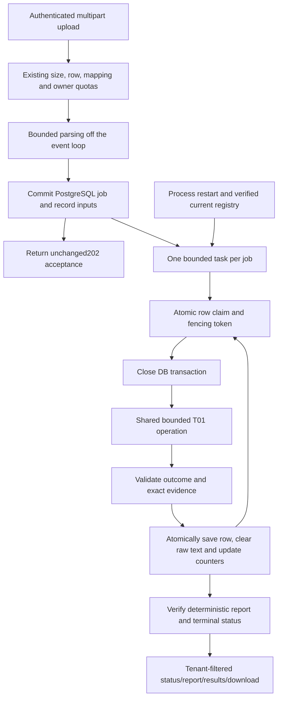

# Durable batch architecture — T09

Production BatchService and FastAPI default to PostgresJobStore. Existing JobStore
is an explicitly injected ephemeral test adapter; it is not a runtime database
fallback. FileParser, analyze_record, SentimentService, Pydantic API models and
ReportingService are reused. No new classifier, graph, remote MCP, queue framework
or unrelated Gmail/webhook persistence.

## Tables and response reconstruction

| Table | Stored fields / invariants |
| --- | --- |
| batch_jobs | Internal integer PK, unique32-hex public ID, trusted tenant ID, typed business_type/source, JSONB column mapping, status, total/valid/invalid/processed/success/failed counters, skipped rows/error, created/started/completed/updated and optional expiry timestamps |
| batch_records | Parent FK with cascade, unique parent+feedback ID and parent+position, original row/date/date status, validation error, pending raw text, PENDING/PROCESSING/SUCCESS/FAILED, attempted/error, sentiment/category/urgency, JSONB aspects/evidence, summary/next step, claim token/deadline and updated time |

Indexes support tenant+public ID, status/recovery order, expiry and parent/record
claim scans. Constraints enforce nonnegative/reconciled counters and terminal/claim
state shapes. Child queries join an already owner-filtered parent; API reads never
fetch a foreign job and then filter it in Python. No tenant/key/proof is added to
public model input/output. Credentials/proofs are never database columns.

Report snapshots are not duplicated. A read reconstructs validated BatchResult
objects from PostgreSQL, rebuilds the existing Job domain projection and uses the
same deterministic ReportingService. Terminal domain raw-record lists are discarded
after report construction. Individual results order by original position and existing
pagination is unchanged; download remains JSON BatchDownload with the same filename
and Content-Disposition. Retrieval never invokes a model.

`processed = successful + failed <= total`. Terminal processed equals total;
COMPLETED has no failures, PARTIAL_SUCCESS both outcome types, FAILED no successes.
An unprocessed row never appears as analyzed in the public results list. Record
validation/provider failures preserve attempted/error semantics and count correctly.

## Worker, transactions and failure handling

The DB pool is bounded and every ORM operation uses its own short Session. Async
routes, parsing, creation, processing writes and maintenance offload blocking work.
Cancellation waits for a pending commit rather than abandoning a thread that may
still commit. The idle management connection holds a PostgreSQL advisory lock without
an ORM transaction; a second coordinator is rejected. Existing global/per-business
HTTP/model/investigation/batch quotas and two batch model permits remain.

Scheduling deduplicates active job IDs. Stale recovery snapshots cannot reopen
terminal jobs. Claims use FOR UPDATE/SKIP LOCKED, expiring leases and compare-token
writes. Normal concurrent claim attempts admit one current claimant, and a stale
token cannot overwrite a replacement. Model calls run after claim commit, without
SQL locks/transactions open. The lease allows the configured model deadline plus
15seconds; abrupt death may leave a claim to age out before retry.

After each outcome the row and job counters commit together, then process-local
progress advances. On database failure the worker preserves committed rows and
pauses unfinished work for recovery. A failure to commit a model result can cause
that one record to be retried; successful committed rows are skipped. A report
integrity failure pauses finalization with a controlled report-unavailable code,
retaining outcomes and avoiding extra model calls merely to rebuild the report.

Fatal provider configuration/authentication errors stop further batch calls, settle
remaining controlled failures and retain the existing process latch. Per-record
nonfatal errors continue; the whole job deadline produces controlled failed outcomes.
Shutdown releases only owned claims after awaited cancellation, clears RAM and closes
the coordination connection/pool; it does not delete database jobs/results.

## Recovery and security boundary

Startup checks explicit Alembic revision and lock, then a bounded lifecycle loop
loads eligible unfinished jobs. Recovery uses current registered BATCH_CREATE
credentials to issue verified owner principals; a stored tenant string alone grants
nothing. Rotation keys share the same tenant history. Removed/read-only owners stay
paused without unauthorized calls. Every public inspection still requires BATCH_READ;
create-only credentials can process but cannot read reports/results/downloads.

Committed SUCCESS and FAILED outcomes are not reprocessed. Gracefully released
claims can resume promptly; hard-crash PROCESSING claims wait until expiry. No
exactly-once external inference claim: crash/response/commit ambiguity permits an
at-least-once retry. Multi-process/distributed deployment is not supported; advisory
locks/fencing protect this single-coordinator architecture, not arbitrary partitioned
workers or all other process-local subsystems.

## Retention and known limits

Default terminal TTL 0 retains reports indefinitely. Positive configured seconds
explicitly enable deletion, including existing terminal jobs. Retained-job quotas
remain and may fill;429 replaces silent eviction. Pending raw input persists only
for recovery and clears on settlement; sensitive derived text persists until policy
deletion. Backups/operator copies have separate lifecycle/security requirements.
Already-lost in-memory jobs cannot be migrated or fabricated.

Real tests use an isolated PostgreSQL 12.22 test database and per-case schemas,
including40 committed/60 resumed rows, stale leases/fencing, restarts/downloads,
permissions, failures, metadata and unchanged response contracts. That server is
end-of-life; supported-version/production verification remains outstanding. No real
Groq/Gmail call occurs. [Setup/backups](POSTGRESQL_BATCH_STORAGE.md),
[Postman steps](POSTMAN_BATCH_PERSISTENCE.md), [evidence](qa/T09_IMPLEMENTATION_REPORT.md).
