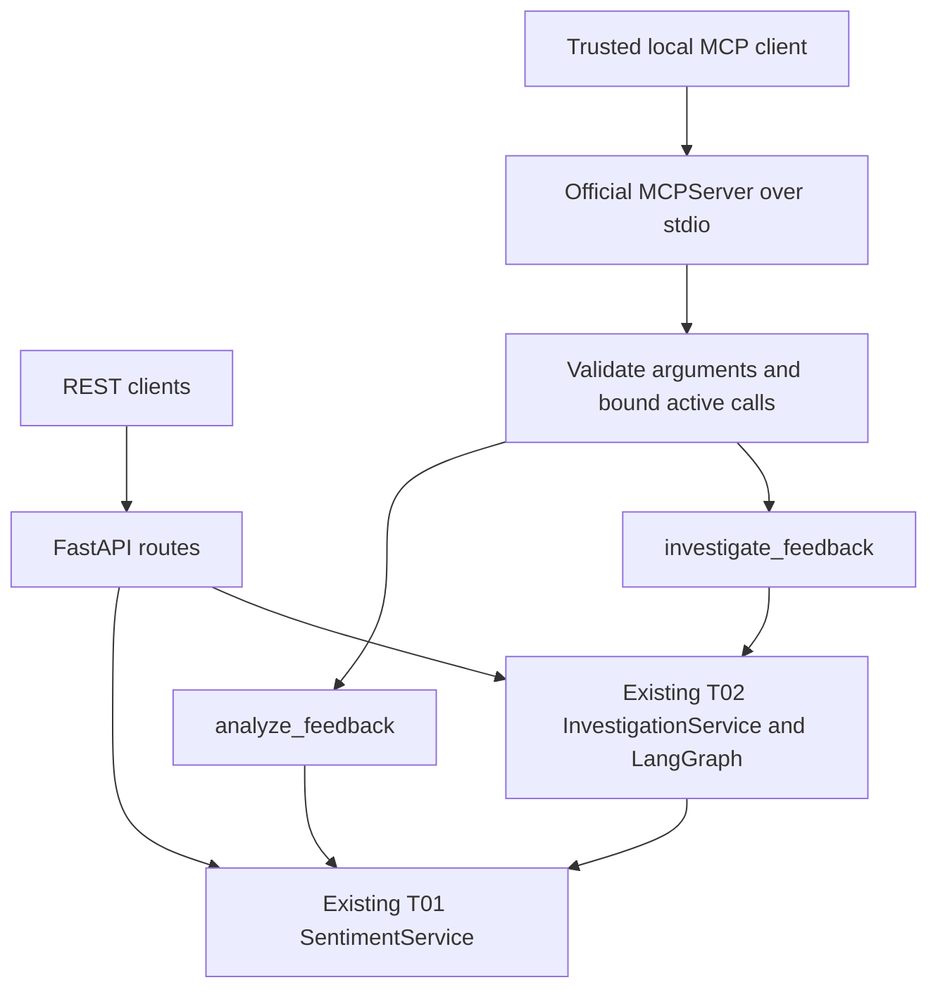

# Local MCP integration (T05)

MCP lets a compatible AI host discover and call our existing analysis capabilities
through typed protocol tools. T05 implements **local stdio only**, using the
official `mcp==2.3.0` Python SDK. No HTTP listener or FastAPI mount is added.



Both transports call Python services directly, without requests to our own REST
API. Separate REST and stdio processes own separate instances, built with the
same service factories and rules. Within one MCP lifespan, both tools share the
same T01 instance; T02 receives that instance. There is no second classifier,
prompt, graph, aggregation implementation, or conversational memory.

## SDK API and source responsibilities

The installed SDK was inspected and exercised rather than using v1/FastMCP
examples. T05 uses:

- `mcp.server.MCPServer`, `@server.tool(structured_output=True)`, async handlers,
  typed Pydantic return values, and injected `mcp.server.mcpserver.Context`.
- `MCPServer.run(transport="stdio")` and a lifespan yielding service references.
- The public `MCPServer.call_tool` seam for raw argument validation, bounded
  admission, and sanitized `mcp.server.mcpserver.exceptions.ToolError` handling.
- Official `mcp.Client`, `Client(server, mode="legacy")` for in-memory protocol
  framing/initialization, modern in-process mode, and `StdioServerParameters` for
  subprocess connections. `client.list_tools()` returns tools and their schemas;
  `client.call_tool()` returns a typed result.

| File | Responsibility |
| --- | --- |
| [server.py](../app/mcp_server/server.py) | Factory, service/client lifespan, validation/error boundary, admission limit, stdio entry point |
| [tools.py](../app/mcp_server/tools.py) | Exactly two typed tool registrations and direct service delegation |
| [sentiment.py](../app/schemas/sentiment.py) | Existing request/result models, shared source/business types, exact-quote validation |
| [investigation.py](../app/schemas/investigation.py) | Existing collection/question constraints and investigation result model |
| [sentiment_service.py](../app/services/sentiment_service.py) | Existing strict Groq output, evidence validation, timeouts, bounded retries |
| [investigation_service.py](../app/services/investigation_service.py) | Existing bounded graph, deterministic findings, evidence verification |

The factory accepts optional settings and injected sentiment/investigation
services for controlled verification. It creates shared sync/async HTTP clients
inside the MCP lifespan and closes owned clients when the connection exits.
Injected services remain caller-owned. Import and discovery require no Groq key
and make no inference requests. No FastAPI route module is imported by MCP code.

## Available tools and schemas

Exactly `analyze_feedback` and `investigate_feedback` are registered. Both reject
unknown fields, explicit nulls for non-optional inputs, and invalid types. The
existing Pydantic request models validate raw arguments before SDK function
parsing, including uniqueness/nonblank checks not expressible by field types
alone. `feedback` must be a JSON array, not a JSON-encoded string. Injected
`Context` and internal service references never appear in tool input schemas.

### analyze_feedback

| Input | Constraint / default |
| --- | --- |
| `text` | Required nonblank string, 1–5000 characters; exact text preserved |
| `source` | `manual` by default; `customer_review`, `support_ticket`, `email`, `social_media`, `manual` |
| `business_type` | `general` by default; `ecommerce`, `restaurant`, `software`, `banking`, `general` |

Example tool arguments:

```json
{
  "text": "The food was excellent, but the delivery was delayed.",
  "source": "customer_review",
  "business_type": "restaurant"
}
```

The output schema is the unchanged `SentimentResponse`: `sentiment`,
`issue_category`, `urgency`, `aspects`, `summary`, `suggested_next_step`, and
`evidence_phrases`. Existing enumerations and output limits apply. Every retained evidence phrase must match an exact input substring. One bounded
correction and strictly validated post-correction filtering can produce an empty
evidence list; it supplies no retained quotation or independent semantic support.
Urgency remains tentative triage. No tool-specific
analysis envelope or alternate classification vocabulary is introduced.

### investigate_feedback

| Input | Constraint / default |
| --- | --- |
| `question` | Required nonblank string, 1–500 characters |
| `feedback` | Required array of 1–10 `{id, text}` objects |
| `feedback[].id` | Unique nonblank string, 1–100 characters |
| `feedback[].text` | Nonblank string, 1–5000 characters |
| `business_type` | Same allowlist; defaults to `general` |

```json
{
  "question": "What are the main customer complaints?",
  "business_type": "ecommerce",
  "feedback": [
    {"id": "R101", "text": "The phone overheats while charging."},
    {"id": "R102", "text": "Battery gets extremely hot."},
    {"id": "R103", "text": "The camera quality is excellent."}
  ]
}
```

The output schema is the unchanged `InvestigationResponse`: `question`,
`selected_action`, `answer`, `total_feedback`, `sentiment_summary`, `top_issues`,
`evidence`, `tools_used`, `limitations`, and `recommendations`. The existing T02
selector, conditional LangGraph paths, Python aggregation, and evidence checks
remain responsible for these findings. Any record failure aborts the whole
investigation; no partial investigation is fabricated.

Python clients read success data from `result.structured_content`; on the wire
the field is `structuredContent`. The SDK also supplies a text representation
for compatible hosts. Tools return validated Pydantic models, not hand-encoded
JSON strings. `inputSchema` and `outputSchema` are discoverable with `tools/list`.

## Launch the server

From the project directory:

```bash
.venv/bin/python -B -m app.mcp_server.server
```

The process waits for an MCP client on stdin. No banner or ordinary output is
expected on stdout; protocol frames belong there. Fixed diagnostic codes go to
stderr. The installed SDK owns stdio framing, cancellation, EOF, and session
teardown; the application lifespan closes HTTP clients. Startup failures emit a
fixed error and exit nonzero without a traceback or environment dump.

Settings use environment variables and the optional ignored project-root `.env`.
Set `GROQ_API_KEY` privately for live analysis; it is not a tool argument.
`GROQ_MODEL`, `GROQ_TIMEOUT_SECONDS`, `GROQ_MAX_RETRIES`, and
`INVESTIGATION_TIMEOUT_SECONDS` retain their existing meanings. `APP_API_KEY`
applies to REST only and is not required for local MCP.

`MCP_MAX_CONCURRENT_CALLS` defaults to **2**, accepts 1–8, and bounds active tool
executions per server instance. Excess requests immediately receive `MCP_BUSY`;
they do not wait in a server-owned queue. Each investigation analyzes at most
ten records sequentially and selects one bounded graph action. T01 retains its
total provider deadline/retry budget; T02 retains its total graph deadline and
recursion limit. These are per-process/per-request limits, not global limits
shared with REST, batch workers, or other MCP processes.

## Connect an official SDK client

The following configuration is for the **official Python SDK client**, which was
actually verified. It uses an absolute interpreter and explicit working directory.
For a safe discovery/configuration check, it explicitly disables Groq credentials:

```python
import asyncio
from mcp import Client
from mcp.client.stdio import StdioServerParameters

server = StdioServerParameters(
    command="/ABSOLUTE/PROJECT/.venv/bin/python",
    args=["-B", "-m", "app.mcp_server.server"],
    cwd="/ABSOLUTE/PROJECT",
    env={"GROQ_API_KEY": "", "MCP_MAX_CONCURRENT_CALLS": "2"},
)

async def main():
    async with Client(server, mode="legacy", cache=None) as client:
        for tool in (await client.list_tools()).tools:
            print(tool.name, tool.input_schema, tool.output_schema)
        result = await client.call_tool("analyze_feedback", {"text": "Example feedback."})
        assert result.is_error  # GROQ_NOT_CONFIGURED, no inference request
        print(result.content)

asyncio.run(main())
```

Client-side printing here belongs to the client process, not server stdout.
For intentional live usage, remove the blank override and supply credentials
privately through the launcher environment or `.env`. The SDK stdio client
inherits only a small safe set of environment variables, so do not assume it
automatically forwards `GROQ_API_KEY` from the parent shell. Calling either tool
with configured credentials can incur provider charges; no live call was made
during T05 verification.

A host may use a configuration resembling the following. This is an illustrative
host-specific shape, **not a compatibility claim for an untested desktop client**:

```json
{
  "mcpServers": {
    "sentiment-intelligence": {
      "command": "/ABSOLUTE/PROJECT/.venv/bin/python",
      "args": ["-B", "-m", "app.mcp_server.server"],
      "cwd": "/ABSOLUTE/PROJECT",
      "env": {"MCP_MAX_CONCURRENT_CALLS": "2"}
    }
  }
}
```

Check the host's supported configuration keys. It must honor the working
directory or otherwise make the `app` package importable. No real secret belongs
in a shared configuration example.

## Errors and verification

Tool execution failures return MCP `CallToolResult` with `is_error=True`
(`isError` on the wire), safe text, and no successful structured analysis.

| Failure | Safe tool-error code |
| --- | --- |
| Invalid fields, bounds, enums, duplicate IDs, unsupported tool | `VALIDATION_ERROR` with fixed input/discovery guidance |
| Missing/unsupported model configuration | Existing `GROQ_NOT_CONFIGURED`, `GROQ_MODEL_UNSUPPORTED`, `GROQ_CONFIGURATION_ERROR` |
| Provider authentication, rate limits, deadlines, availability | Existing `UPSTREAM_*` codes |
| Invalid classification, selector, graph, or evidence | Existing `INVALID_MODEL_RESPONSE`, `INVALID_ACTION_SELECTION`, `INVALID_GRAPH_STATE`, `EVIDENCE_VERIFICATION_FAILED` |
| Whole-investigation deadline | `INVESTIGATION_TIMEOUT` |
| Capacity exhausted | MCP-local `MCP_BUSY` |
| Unexpected internal/SDK execution failure | `INTERNAL_ERROR` |

Application errors are recovered by type through SDK exception wrappers, never
by parsing raw exception text. Rejected argument values, provider bodies, paths,
stack traces, and secrets are not returned. SDK/provider debug logging is
suppressed even if application `LOG_LEVEL=DEBUG`. Protocol framing/envelope
errors remain SDK JSON-RPC protocol errors, distinct from tool execution results.

Automated verification uses tests/integration/test_mcp_server.py and the final
submission regressions, including official in-process and subprocess stdio clients. To reproduce service-path checks, inject a
`SentimentService` with an async mock `ainvoke` model and an
`InvestigationService` using an injected `ActionSelector`. Connect through
`Client(create_mcp_server(...), mode="legacy", cache=None)`, discover tools, call
both tools, and validate `structured_content` with the existing response models.
Check invalid payloads, configuration/provider errors, ungrounded evidence,
capacity, and cancellation through the protocol rather than direct functions.
The no-key subprocess example above checks the installed executable path and
discovery without authorizing live inference. Locked dependency checks remain:

```bash
uv sync --locked --offline
uv pip check
```

Use the project-local uv exports from [README](../README.md) first. SDK upgrades
must repeat protocol/error-path checks; T05 uses the pinned 2.3.0 interfaces.

## Security boundary and deferred capabilities

Local stdio authority comes from the trusted user/application that launches the
process with its environment and credentials. No REST key is passed as a tool
argument. `business_type` and feedback IDs establish no identity or ownership.
Any launcher with access to provider credentials can invoke the exposed analysis
capabilities. This is **not multi-tenant authentication**.

Only the two approved analysis tools are exposed. There are no MCP resources,
prompts, filesystem/shell/Python/database tools, Gmail/webhook management,
batch-job lookup, or report retrieval. Batch results remain REST-only by the intentionally limited MCP scope; REST
tenant ownership is implemented and is not a missing prerequisite. This is a narrow registered capability surface,
not an OS sandbox, policy engine, capability proxy, or network egress firewall.
The tools send supplied feedback to the configured provider for inference.

The server creates no feedback database, upload, export, transcript, checkpoint,
or persistent conversation state. Requests/results are temporary process data;
this is not cryptographic memory erasure. Client hosts may independently retain
arguments, responses, full source evidence, and conversation history. Treat
those derived outputs as sensitive and configure host retention separately.

Remote MCP remains unimplemented. A future separately authorized HTTP transport
needs transport authentication, per-principal authorization, tenant-scoped data
access, TLS, Host/Origin protection, rate/resource limits, and secure credentials.
No public listener or automatic FastAPI mount is part of T05. Live inference and
specific external desktop-client compatibility remain unverified. Production remote transport remains outside the implemented scope.

References: [official SDK repository](https://github.com/modelcontextprotocol/python-sdk),
[SDK clients](https://py.sdk.modelcontextprotocol.io/client/),
[structured output](https://py.sdk.modelcontextprotocol.io/servers/structured-output/),
[server execution](https://py.sdk.modelcontextprotocol.io/run/).


## T07 business-isolation boundary

REST authenticates business credentials and enforces owned resources, including
PostgreSQL batch/event results and the durable Gmail message ledger. This does not change local stdio authority: the trusted process launcher
still authorizes the two stateless analysis tools. There are no tenant_id/api_key
arguments, owned batch/event lookup tools, credential registry tools or remote
transport. A business registry in settings is never exposed by discovery/results.
New and existing official in-process/stdio regression checks cover this boundary.

A future tenant-specific MCP deployment must obtain identity from a trusted
launcher/host binding outside model/tool arguments, validate it against server
policy and pass verified context into service accounting. Per-process MCP limits
remain separate from REST quotas/provider account limits. No such remote/tenant
MCP deployment was implemented in T07; do not infer it from REST authentication.


## Real external-client acceptance still pending

**Not completed by official SDK unit/in-process/subprocess tests.** The final audit
adds official-client reduced-evidence checks but makes no external-host success claim.
No external platform was connected or configured during the audit.

For an installed MCP-capable VS Code client, use its guided MCP: Add Server /
Command (stdio) flow in a personal configuration. Follow the
[official client instructions](https://code.visualstudio.com/docs/agent-customization/mcp-servers);
formats and available harnesses depend on the installed client. This example uses
the portable mcpServers format, not the VS Code-specific servers wrapper:

```json
{
  "mcpServers": {
    "sentiment-intelligence": {
      "command": "/ABSOLUTE/PROJECT/.venv/bin/python",
      "args": ["-B", "-m", "app.mcp_server.server"],
      "env": {
        "PYTHONPATH": "/ABSOLUTE/PROJECT",
        "GROQ_API_KEY": "",
        "MCP_MAX_CONCURRENT_CALLS": "2"
      }
    }
  }
}
```

Replace both absolute paths with the local project path. PYTHONPATH makes module
import independent of a host-specific cwd option. The explicit blank key overrides
a private .env for safe discovery without paid inference. Do not paste real keys
into chat or a shared/committed configuration. Use personal host configuration.

1. Review and start only this trusted command in the installed host. Inspect its
   connection/error panel. Discovery must show exactly analyze_feedback and
   investigate_feedback, with expected schemas and no extra capabilities.
2. Ask the host to call analyze_feedback with {"text":"Synthetic feedback."}.
   With the blank override, expect a controlled GROQ_NOT_CONFIGURED tool error.
   This verifies connection/error transport only, not successful inference.
3. For intentional live acceptance, the owner may explicitly authorize/configure
   Groq privately in the host environment and remove the blank override. Call both
   tools with synthetic feedback and inspect the actual structured tool responses,
   not just plausible host-generated prose. Use an investigation with 1–10 records.
4. Record host/version, date, discovered tool names, each call's status and sanitized
   evidence of validation. Keep prompts/data/keys/authorization headers private.
   Do not mark successful external-client acceptance until those actual calls pass.

These are reliable server/protocol instructions plus a documentation-checked host
setup route, **not a claim that a specific desktop host was exercised here**. Client
account/extension availability and trust/approval prompts remain owner-controlled.
