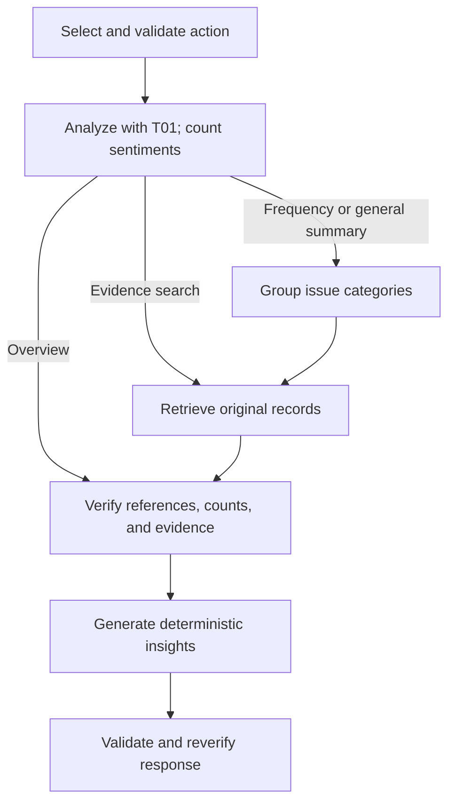

# Agentic Sentiment Intelligence

An API-first backend for customer feedback sentiment analysis, aspect extraction,
issue categorization, and temporary bulk reports.

T01 implements a reusable sentiment service and REST endpoint. T02 adds a bounded
LangGraph investigation over request-supplied feedback. T03 exposes both through
one stateless conversational endpoint with explicit modes. T04 adds CSV/XLSX
uploads, bounded asynchronous jobs, and deterministic JSON reports. A public
health check is also available. T05 exposes the shared analysis/investigation
services as two local stdio MCP tools. T09 persists batch jobs/results in PostgreSQL; chat history and remote MCP remain
future work. Gmail OAuth/connections/jobs remain process-local; processed-message
identities now persist in PostgreSQL for incremental importing.
T06 adds authenticated direct feedback ingestion, signed generic webhook triggers,
bounded background processing, and development/admin event status. See
[webhook integration](docs/WEBHOOK_INTEGRATION.md) for contracts, signing examples,
limits and restart/privacy restrictions. T07 adds verified business credentials,
owner-scoped jobs/events and tenant quotas; see [tenant isolation](docs/TENANT_ISOLATION.md).
T08 adds read-only Gmail OAuth and explicitly triggered, tenant-scoped feedback
imports over the same T01 service; see [Gmail integration](docs/GMAIL_INTEGRATION.md).

## Stack

- CPython 3.12.16, managed locally by uv 0.13.6.
- FastAPI and Uvicorn for the REST API.
- Pydantic v2 and pydantic-settings for validation and configuration.
- Groq through langchain-groq; LangGraph coordinates request-local investigations.
- Official MCP Python SDK 2.3.0.
- Python's CSV reader and openpyxl for ingestion, Pandas for aspect grouping;
  httpx for integrations.
- PostgreSQL with SQLAlchemy2.x, Alembic migrations and psycopg3 for durable batches.

`pyproject.toml` constrains Python to 3.12 and the uv version to 0.13.6.
`uv.lock` records exact dependency versions and distribution hashes. The full
LangChain umbrella package is not a direct dependency.

## Prerequisites

A writable project directory and approved HTTPS access to Astral/GitHub, PyPI,
and package download hosts are needed for first-time provisioning. All tools,
managed Python installations, and caches stay inside this project. System Python
and shell profiles remain unchanged. Do not use sudo.

Git is temporarily unavailable in this environment: `.git` is an empty, read-only
mount. Do not modify it, initialize another repository, or change Git settings.
Python setup and development do not depend on Git functionality.

## First-time provisioning

From this project directory, download the official versioned installer and inspect
it before executing it:

```bash
curl -fLsS https://astral.sh/uv/0.13.6/install.sh -o /tmp/t00-uv-install.sh
```

After inspecting the script, install uv into the project:

```bash
UV_UNMANAGED_INSTALL="$PWD/.tools/bin" sh /tmp/t00-uv-install.sh
```

Use the environment exports in the next section, then provision the pinned
interpreter and install the locked dependencies:

```bash
uv python install 3.12.16
uv sync --locked
uv pip check
```

Use `uv sync --locked --offline` only when the required interpreter and package
artifacts are already available locally. Keep `uv.lock` with the project files;
do not regenerate it just to start development.

## Start a development shell

```bash
cd /home/rails/agentic-sentiment-intelligence
export PATH="$PWD/.tools/bin:$PATH"
export UV_PYTHON_INSTALL_DIR="$PWD/.tools/python"
export UV_PYTHON_BIN_DIR="$PWD/.tools/bin"
export UV_CACHE_DIR="$PWD/.cache/uv"
export UV_PYTHON_CACHE_DIR="$PWD/.cache/uv-python"
export UV_PROJECT_ENVIRONMENT="$PWD/.venv"

source .venv/bin/activate
python --version
uv --version
```

Alternatively, after the exports, run commands with `uv run --locked` without
activating the environment. These exports apply to the current shell only.

## Local configuration

When a later implementation task needs configuration, copy the example:

```bash
cp .env.example .env
```

Set `GROQ_API_KEY` privately before live inference. `GROQ_MODEL`, `APP_ENV`,
`LOG_LEVEL`, and private PostgreSQL `DATABASE_URL` configure the application.
Settings load from environment variables and the optional project-root `.env`;
environment variables take precedence. No real `.env` or database is created by
T01. Never print credentials or customer feedback in logs.

| Setting | Default / purpose |
| --- | --- |
| `APP_ENV` | `development`; also `test` or `production` |
| `LOG_LEVEL` | `INFO`; application logging level |
| `APP_API_KEY` | Unset; expected development `X-API-Key` value |
| `GROQ_API_KEY` | Unset; Groq provider credential |
| `GROQ_MODEL` | `openai/gpt-oss-20b` |
| `GROQ_TIMEOUT_SECONDS` | `30`; total deadline including retries/backoff, maximum 120 |
| `GROQ_MAX_RETRIES` | `2`; transient retries after the first attempt, range 0–3 |
| `INVESTIGATION_TIMEOUT_SECONDS` | `120`; total investigation deadline, maximum 300 |
| `MCP_MAX_CONCURRENT_CALLS` | `2`; active calls per local MCP server, range 1–8; excess calls fail immediately |
| `API_DOCS_ENABLED` | Optional override; docs enabled outside production by default |
| `DATABASE_URL` | Private PostgreSQL+psycopg URL; required for batch persistence, no SQLite fallback |
| `BATCH_JOB_TTL_SECONDS` | `0`: indefinite terminal retention; positive seconds explicitly enable deletion |

Both keys may be absent at startup. `/health` is still available. Set a private
application key to authenticate analysis requests, and a private Groq key before
live inference. Changing configuration requires restarting the server.

## Run the development server

Batch and persistent feedback ingestion require a running PostgreSQL database
and an explicit Alembic upgrade before startup.
Follow [PostgreSQL setup](docs/POSTGRESQL_BATCH_STORAGE.md) first; replace any old
SQLite DATABASE_URL and set BATCH_JOB_TTL_SECONDS=0, including overrides copied into
an older private .env. Missing database configuration disables batch work503;
configured but unavailable/unmigrated/locked databases fail startup safely.

After starting the development shell and configuring the private PostgreSQL URL:

```bash
uv run --locked alembic upgrade head
```

Then start the existing server:

```bash
uv run --locked uvicorn app.main:app --host 127.0.0.1 --port 8000 --reload --reload-dir app --no-access-log
```

Development documentation is available at `/docs`, `/redoc`, and `/openapi.json`.
The health endpoint checks process liveness only, not provider readiness:

```bash
curl http://127.0.0.1:8000/health
```

```json
{"status": "ok"}
```

## Analyze feedback

`POST /api/v1/sentiment/analyze` requires the `X-API-Key` header. The key must
match a server-configured business credential using constant-time digest comparison.
Legacy `APP_API_KEY` works only in the documented development compatibility mode
and owns only tenant development. Missing/invalid credentials return 401; absent
server authentication configuration returns 503. [T07 policy](docs/TENANT_ISOLATION.md)
describes production configuration, permissions and owner isolation.

Request fields:

- `text`: required string, 1–5000 characters, with a non-whitespace character.
  The original text is preserved for evidence matching.
- `source`: defaults to `manual`; supported values are `customer_review`,
  `support_ticket`, `email`, `social_media`, and `manual`.
- `business_type`: defaults to `general`; supported hints are `ecommerce`,
  `restaurant`, `software`, `banking`, and `general`. It is never an identity or
  authorization claim. Arbitrary instructions and unknown fields are rejected.

Optional fields may be omitted; explicit `null` is not accepted. Request example:

```json
{
  "text": "The food was delicious, but the delivery was very late.",
  "source": "customer_review",
  "business_type": "restaurant"
}
```

For a local request, provide the same privately configured application key in your
shell's `APP_API_KEY` variable. This command sends feedback to Groq if both keys
are configured; live inference is outside the no-network development checks:

```bash
curl --request POST http://127.0.0.1:8000/api/v1/sentiment/analyze \
  --header 'Content-Type: application/json' \
  --header "X-API-Key: ${APP_API_KEY}" \
  --data '{"text":"The food was delicious, but the delivery was very late.","source":"customer_review","business_type":"restaurant"}'
```

Illustrative response only, not an observed or guaranteed model result:

```json
{
  "sentiment": "MIXED",
  "issue_category": "DELIVERY",
  "urgency": "MEDIUM",
  "aspects": [
    {"name": "food_quality", "sentiment": "POSITIVE"},
    {"name": "delivery_time", "sentiment": "NEGATIVE"}
  ],
  "summary": "The customer liked the food but reported late delivery.",
  "suggested_next_step": "Review delivery performance and related feedback.",
  "evidence_phrases": ["food was delicious", "delivery was very late"]
}
```

Sentiment is `POSITIVE`, `NEGATIVE`, `NEUTRAL`, or `MIXED`. Urgency is `LOW`,
`MEDIUM`, `HIGH`, or `CRITICAL`: suggested triage, **not a verified safety
assessment or calibrated risk score**. No confidence score is returned.

Issue categories are `DELIVERY`, `PRODUCT_QUALITY`, `FOOD_QUALITY`, `BILLING`,
`CUSTOMER_SUPPORT`, `TECHNICAL_ISSUE`, `STAFF_BEHAVIOR`, `FEATURE_REQUEST`,
`PRAISE`, and `OTHER`. Aspect names use lowercase snake_case, at most 64
characters. There are at most 20 aspects and 20 evidence phrases. Summary and
next-step text must each be nonblank and at most 1000 characters.

Every evidence phrase must be an exact, case-sensitive contiguous substring of
the submitted feedback. Empty lists are allowed; invented or paraphrased quotes
cause the entire analysis to fail with a controlled 502. Schema adherence and
quote matching do not independently prove the accuracy of sentiment or summaries.

## Groq service and errors

The installed ChatGroq 1.1.3 adapter supports `method="json_schema", strict=True`.
The service sends required fields and closed objects, then validates again with
Pydantic and the original feedback as evidence context. It does not fall back to
best-effort mode or free-form output. Local length/name checks run in validators
without assuming provider support for JSON Schema length/pattern extensions.

This adapter version forwards strict mode for `openai/gpt-oss-20b` and
`openai/gpt-oss-120b`. Other `GROQ_MODEL` values return a controlled configuration
error instead of silently weakening output enforcement. The default remains
`openai/gpt-oss-20b`.

SDK retries are disabled. The service alone retries connection failures,
timeouts, HTTP 408/409/429, and HTTP 5xx with bounded exponential backoff. Numeric
`Retry-After` values are respected when they fit the total deadline. Credentials,
other request/configuration errors, and general invalid model results are not retried.
An otherwise valid result rejected specifically for nonexact evidence gets at most
one correction generation with fixed verbatim-quotation guidance. The entire retry
uses the same original feedback, strict schema, admission permit and total deadline.
The correction has no additional provider-retry loop; provider errors on that call
retain their sanitized error code and stop. Total model invocations are bounded by
GROQ_MAX_RETRIES + 2 (default 4), rather than resetting a retry budget per generation.
If that correction still fails ONLY exact grounding, the service drops nonexact
evidence phrases and fully revalidates the response against the original text.
It changes no other fields and makes no further model call. An empty evidence list
is allowed by the existing contract: it means no model quotation was retained, not
that the classification or summary is independently substantiated. All unrelated
schema/parser/provider failures still reject. See [sanitization policy and verification](docs/qa/EVIDENCE_SANITIZATION_REPORT.md).
The total deadline includes every attempt and delay. HTTP clients are shared for
the application lifespan and closed on shutdown.

Invalid-output warnings now distinguish SDK response validation, structured-output
parsing, unexpected result types, Pydantic schema violations and exact evidence
grounding. Logs contain only fixed categories/stages and allowlisted field paths;
they never include model output, exception text or feedback. The public error stays
`INVALID_MODEL_RESPONSE`. Successful evidence recovery emits only a fixed diagnostic
category. This targeted correction can incur one additional billable Groq call per
logical analysis; no correction call is made for an initially valid response or
unrelated invalid output. See [recovery bounds, tests and live retest steps](docs/qa/EVIDENCE_GROUNDING_RECOVERY.md)
and [the original diagnostics audit](docs/qa/SENTIMENT_MODEL_DIAGNOSTICS.md).

| HTTP | Error code / condition |
| --- | --- |
| 401 | `AUTHENTICATION_FAILED`: missing or invalid application key |
| 422 | `VALIDATION_ERROR`: malformed input; field details omit submitted values |
| 429 | `UPSTREAM_RATE_LIMITED` after permitted retries |
| 502 | `UPSTREAM_AUTHENTICATION_FAILED`, `UPSTREAM_REQUEST_REJECTED`, `UPSTREAM_UNAVAILABLE`, or `INVALID_MODEL_RESPONSE` |
| 503 | `APP_AUTH_NOT_CONFIGURED`, `GROQ_NOT_CONFIGURED`, `GROQ_MODEL_UNSUPPORTED`, or `GROQ_CONFIGURATION_ERROR` |
| 504 | `UPSTREAM_TIMEOUT` |
| 500 | `INTERNAL_ERROR`: generic unexpected failure |

Errors contain `error.code`, a safe `error.message`, and a generated `request_id`.
Validation errors also include sanitized field details. Responses include an
`X-Request-ID` header. Provider bodies, stack traces, credentials, and raw feedback
are excluded from client errors and application logs. Provider debug logging is
suppressed and LangSmith tracing is disabled context-locally during analysis.
`groq` and `langsmith` are explicit dependencies for these error/privacy controls;
T01 did not change their installed versions or add another framework.

## Reuse and verification limits

`SentimentService.analyze(SentimentRequest(...))` returns a validated
`SentimentResponse` independently of FastAPI. A small injectable model interface
allows development verification without provider calls. `create_app` accepts
settings and a service, and the REST dependency can also be overridden.
Future adapters must authenticate their callers before using the service.

Basic development checks can exercise `/health`, OpenAPI, request validation,
authentication, configuration errors, and injected provider responses without
real credentials or network inference. T01–T03 originally deferred automated
tests; QA and T06 now provide them. One authorized live T01 request later passed;
broad model accuracy, quotas and live operation of every interface remain unverified.

`.gitignore` excludes tools, caches, virtual environments, local settings,
databases, credentials, uploads, and temporary feedback. Keep temporary data
under `.local/`, `uploads/`, `tmp/`, `feedback_tmp/`, or `analysis_tmp/`.
An ignore file does not replace secret management or a retention policy.

## Investigate submitted feedback

`POST /api/v1/agent/investigate` uses the existing `X-API-Key` authentication.
It accepts a nonblank question of at most 500 characters and **1–10 feedback
records**. Each ID is a unique nonblank string of at most 100 characters; each
feedback text is nonblank and at most 5000 characters. Unknown fields are rejected.
Business types use the T01 allowlist, defaulting to `general`. IDs are source
references within this request, not database identities or authorization claims.

Example request:

```json
{
  "question": "What are the main negative issues in this feedback?",
  "business_type": "ecommerce",
  "feedback": [
    {"id": "R101", "text": "My phone overheats while charging."},
    {"id": "R102", "text": "Battery gets extremely hot."},
    {"id": "R103", "text": "The camera quality is excellent."}
  ]
}
```

Illustrative response, not observed live inference:

```json
{
  "question": "What are the main negative issues in this feedback?",
  "selected_action": {
    "action": "ISSUE_FREQUENCY", "category": null,
    "sentiment": null, "evidence_limit": 3
  },
  "answer": "Negative or mixed records grouped by primary issue category: PRODUCT_QUALITY: 2.",
  "total_feedback": 3,
  "sentiment_summary": {"POSITIVE": 1, "NEGATIVE": 2, "NEUTRAL": 0, "MIXED": 0},
  "top_issues": [
    {"category": "PRODUCT_QUALITY", "count": 2, "feedback_ids": ["R101", "R102"]}
  ],
  "evidence": [
    {"feedback_id": "R101", "text_excerpt": "My phone overheats while charging."},
    {"feedback_id": "R102", "text_excerpt": "Battery gets extremely hot."}
  ],
  "tools_used": [
    "analyze_feedback_items", "aggregate_sentiment", "aggregate_issues",
    "retrieve_evidence", "generate_insights"
  ],
  "limitations": [
    "Findings are based only on the submitted feedback; no external records or historical trends were checked.",
    "Sentiments, categories, and aspects are model classifications, not independently verified business facts.",
    "Issue frequencies count NEGATIVE or MIXED records by their single primary category under the selected filters.",
    "Recommendations are tentative suggestions, not observed facts, safety assessments, or actions taken.",
    "Evidence contains at most 3 matching records; sentiment totals cover all submitted records."
  ],
  "recommendations": [
    "Consider reviewing the cited feedback and relevant business records before choosing a response."
  ]
}
```

### Operations and graph

| Selected action | Operations after classification |
| --- | --- |
| `SENTIMENT_OVERVIEW` | Verify sentiment totals and render the distribution |
| `ISSUE_FREQUENCY` | Group matching complaints, retrieve evidence, verify |
| `EVIDENCE_SEARCH` | Filter by assigned category/sentiment, retrieve original records, verify |
| `GENERAL_FEEDBACK_SUMMARY` | Group complaints, retrieve evidence, verify, summarize aspect frequencies |



The selector sees only the question, action descriptions, and business-type hint.
It never receives review text, source IDs, or tool outputs. One strict structured
selection chooses an allowlisted action with validated filters; no arbitrary
tool execution, repeated selection, or fallback occurs. All actions analyze the
entire supplied dataset once, so sentiment totals always cover every record.
Conditional routing controls whether issue grouping and evidence retrieval run.

Overview/general actions require null filters. Frequency actions default to
NEGATIVE and MIXED records together; optional category and exact NEGATIVE or
MIXED filters narrow the result. Evidence search intersects optional exact
primary-category and sentiment filters. It is not unrestricted semantic search,
and secondary topics may be missed. `top_issues` is empty for overview/evidence
actions. Counts are per unique record; issue categories sort by descending count
then category name, with lexical ID ordering. General summaries also compute up
to five positive/mixed and five negative/mixed aspect frequencies per record.

Evidence defaults to three records with an allowed limit of 1–10. It prioritizes
ranked complaint categories, or lexical IDs for evidence search. General summaries
without complaints may cite other records; sentiment-only overviews return no
evidence. Original text is returned, bounded by the input limit, and checked
against its source ID. Source references, all counts, and filter membership are
reverified before response delivery. Answers are deterministic explanations of
these classifications, with tentative recommendations in a separate field.

### Limits and failure policy

Records are analyzed sequentially through the unchanged T01 service. Any record
failure aborts the request; partial counts or fabricated replacement results are
never returned. The selector uses one attempt without retries. Classification
retains T01's bounded retry policy, so ten records mean at most 11 logical model
calls or 31 provider attempts with the default two retries (41 with three).
No graph-level retries are configured. Per-provider deadlines remain in force;
`INVESTIGATION_TIMEOUT_SECONDS` bounds the entire graph, with a 12-step recursion
limit and no back edges. Limits apply per request, not across all clients.

There are no checkpoints, caches, persistent memory, external lookups, or final
LLM prose generation. The ten-record limit is an initial operational constraint;
larger uploads use T04's separate bulk API. Sentiment labels are inferred, not verified
business facts, and no historical trends or root causes are invented.

Additional controlled errors are `INVALID_ACTION_SELECTION` (502),
`EVIDENCE_VERIFICATION_FAILED` (502), `INVALID_GRAPH_STATE` (500), and
`INVESTIGATION_TIMEOUT` (504). Existing provider/authentication errors retain their
T01 codes. Bad selections fail before any review analysis. LangGraph and provider
tracing are disabled during execution. No dependencies changed in T02.

`InvestigationService.investigate(InvestigationRequest(...))` is independently
callable without FastAPI. T05's MCP investigation tool delegates to that service;
it does not expose the five internal graph tools as separate MCP capabilities.

## Stateless conversational API

`POST /api/v1/chat` uses the same `X-API-Key` authentication and controlled error
responses as the original endpoints. Both `mode` and `message` are required.
Message text must contain a non-whitespace character and be at most 500
characters. Business types use the existing allowlist and default to `general`.

| Mode | Required current-request data | Delegation |
| --- | --- | --- |
| `ANALYZE_TEXT` | `feedback_text`: nonblank string, at most 5000 characters | Existing T01 sentiment service |
| `INVESTIGATE_FEEDBACK` | `feedback`: 1–10 valid records with unique IDs | Existing T02 investigation service and graph |

Each mode rejects a non-null payload belonging to the other mode. The unused
field may be omitted or null. Missing required data, conflicting payloads,
invalid modes, unknown fields, duplicate IDs, and invalid lengths return 422.
Shared text/question/batch constraints and existing T01/T02 validators are reused.
There is no keyword-based mode selection. Business hints and record IDs remain
data, not tenant identities.

### Direct analysis mode

```json
{
  "mode": "ANALYZE_TEXT",
  "message": "Analyze this customer feedback.",
  "feedback_text": "The product is excellent, but delivery was delayed.",
  "business_type": "ecommerce"
}
```

Illustrative response, not an observed Groq result:

```json
{
  "mode": "ANALYZE_TEXT",
  "answer": "The feedback is classified as mixed sentiment. The primary category is delivery. Suggested triage urgency is medium; this is not a verified safety assessment.",
  "sentiment_analysis": {
    "sentiment": "MIXED",
    "issue_category": "DELIVERY",
    "urgency": "MEDIUM",
    "aspects": [
      {"name": "product_quality", "sentiment": "POSITIVE"},
      {"name": "delivery", "sentiment": "NEGATIVE"}
    ],
    "summary": "The customer likes the product but reports delayed delivery.",
    "suggested_next_step": "Review the delivery experience.",
    "evidence_phrases": ["product is excellent", "delivery was delayed"]
  },
  "investigation": null,
  "limitations": [
    "Analysis is based only on the feedback supplied in this request.",
    "Classifications are model inferences, not independently verified business facts.",
    "Requests are stateless; include the relevant feedback again for each question."
  ]
}
```

Only `feedback_text` is sent to T01 as feedback; `message` is not concatenated
into a prompt or classified as customer text. The explanation uses a deterministic
template based on validated sentiment, category, and triage urgency. It does not
rewrite the model summary, infer causes, promise resolution, or make another
Groq request for presentation. Arbitrary formatting instructions in `message`
are not executed.

### Investigation mode

```json
{
  "mode": "INVESTIGATE_FEEDBACK",
  "message": "What are the main customer complaints?",
  "business_type": "ecommerce",
  "feedback": [
    {"id": "R101", "text": "My phone overheats while charging."},
    {"id": "R102", "text": "The battery gets extremely hot."},
    {"id": "R103", "text": "Excellent camera quality."}
  ]
}
```

The response uses the same five-field envelope. The following is a shortened
illustrative excerpt; the full nested investigation has the unchanged T02
schema documented above:

```json
{
  "mode": "INVESTIGATE_FEEDBACK",
  "answer": "Negative or mixed records grouped by primary issue category: PRODUCT_QUALITY: 2.",
  "sentiment_analysis": null,
  "investigation": {
    "question": "What are the main customer complaints?",
    "answer": "Negative or mixed records grouped by primary issue category: PRODUCT_QUALITY: 2.",
    "total_feedback": 3,
    "sentiment_summary": {"POSITIVE": 1, "NEGATIVE": 2, "NEUTRAL": 0, "MIXED": 0},
    "top_issues": [
      {"category": "PRODUCT_QUALITY", "count": 2, "feedback_ids": ["R101", "R102"]}
    ]
  },
  "limitations": [
    "Findings are based only on the submitted feedback; no external records or historical trends were checked.",
    "Requests are stateless; include the relevant feedback again for each question."
  ]
}
```

The actual nested result includes every T02 field: selected action, counts,
issue groups, verified evidence, tools used, limitations, and recommendations.
`answer` exactly matches `investigation.answer`. All T02 limitations are retained
at the envelope level, followed by the stateless-request limitation. Statistics,
routing, and evidence verification remain entirely within the existing T02
implementation. Conversation formatting adds no model calls or retries.

### Stateless behavior and errors

There is no persistent conversation memory, session identifier, automatic intent
detection, or optional history in T03. `history` and `business_id` fields are
rejected. Include the relevant feedback and a self-contained question again on
every call. Missing context produces validation errors asking for the current
payload; the server does not invent earlier feedback or resolve pronouns against
an unavailable previous conversation.

Missing/invalid application credentials return 401. Input and mode errors return
422 with sanitized details. Existing provider/configuration/time-limit errors
retain their status codes and machine-readable error codes. Unexpected failures
remain sanitized 500 responses. No new authentication system, feedback logging,
database writes, analysis engine, or graph was introduced. There are no T03
configuration or dependency additions.

`ConversationService.respond(ChatRequest(...))` is independently callable without
FastAPI. The HTTP dependency supplies the same application-owned T01/T02 service
instances. Direct calls revalidate input as well. Successful responses always
contain `mode`, `answer`, `sentiment_analysis`, `investigation`, and `limitations`,
with exactly one populated result. Normal chat usage has the same model-call
budget and timeouts as the selected underlying operation.

## Bulk CSV / Excel analysis (T04)

All five batch routes require the same `X-API-Key` header as the other analysis
routes. T07 assigns each job to the authenticated business and enforces ownership
for all reads, including direct service/store calls. The legacy development key
owns only development jobs. `business_type` remains a hint, never authority.
Opaque IDs are not a replacement for authorization.

| Method | Endpoint | Response |
| --- | --- | --- |
| POST | `/api/v1/batch/upload` | 202 `JobAccepted` after file validation |
| GET | `/api/v1/batch/jobs/{job_id}` | 200 `JobStatus` |
| GET | `/api/v1/batch/jobs/{job_id}/report` | 200 `BatchReport`; 202 `JobStatus` while pending/running |
| GET | `/api/v1/batch/jobs/{job_id}/results` | 200 `ResultsPage`, including settled results during processing |
| GET | `/api/v1/batch/jobs/{job_id}/download` | 200 JSON attachment with `report` and `results`; 202 `JobStatus` while processing |

### Upload and poll

Use multipart/form-data. `file` and `text_column` are required. Optional
`id_column` and `date_column` must name distinct existing columns. Headers and
mapping names are trimmed and matched case-sensitively; empty or duplicate
headers and duplicate or unexpected form fields are rejected. The first row is
always the header. Omit optional mappings rather than sending empty values.
Unmapped columns are discarded after validation.

`business_type` defaults to `general` and accepts the existing `ecommerce`,
`restaurant`, `software`, `banking`, and `general` values. `source` defaults to
`file_upload` and accepts a nonblank label of at most 64 characters. It is report
metadata; the unchanged T01 classifier receives its existing `manual` source.

For example, a local file may have columns `review_id,feedback,review_date`:

```bash
curl -X POST http://127.0.0.1:8000/api/v1/batch/upload \
  -H "X-API-Key: $APP_API_KEY" \
  -F 'file=@feedback.csv;type=text/csv' \
  -F 'text_column=feedback' -F 'id_column=review_id' \
  -F 'date_column=review_date' -F 'business_type=ecommerce'
```

For Excel, use `file=@feedback.xlsx;type=application/vnd.openxmlformats-officedocument.spreadsheetml.sheet`
with the same mappings. Do not upload actual customer data for development checks.
An illustrative acceptance response is:

```json
{
  "job_id": "0123456789abcdef0123456789abcdef",
  "status": "PENDING",
  "total_records": 3,
  "message": "Bulk analysis job accepted."
}
```

Set `JOB_ID` to the returned ID, then poll and retrieve results:

```bash
curl -H "X-API-Key: $APP_API_KEY" "http://127.0.0.1:8000/api/v1/batch/jobs/$JOB_ID"
curl -H "X-API-Key: $APP_API_KEY" "http://127.0.0.1:8000/api/v1/batch/jobs/$JOB_ID/report"
curl -H "X-API-Key: $APP_API_KEY" "http://127.0.0.1:8000/api/v1/batch/jobs/$JOB_ID/results?page=1&page_size=25"
curl -OJ -H "X-API-Key: $APP_API_KEY" "http://127.0.0.1:8000/api/v1/batch/jobs/$JOB_ID/download"
```

`page` accepts 1–1,000,000; `page_size` accepts 1–100 (default 25). An out-of-range
page returns an empty list. Results stay in source-row order. Job IDs are exactly
32 lowercase hexadecimal characters. Unknown and expired IDs both return 404
`BATCH_JOB_NOT_FOUND`; malformed IDs and pagination return sanitized 422 errors.

### File and row policy

CSV supports strict UTF-8 with or without BOM and comma delimiters, including
escaped double quotes and quoted newlines. Bare quotes, unterminated fields,
trailing characters after closing quotes, NUL bytes, or inconsistent meaningful
row widths are rejected. Explicit non-UTF-8 charsets are rejected. File types
are restricted by extension, MIME, and actual parsing; filenames never become
filesystem paths. CSV accepts `text/csv`, `application/csv`, `text/plain`,
`application/vnd.ms-excel`, or `application/octet-stream`.

Excel supports `.xlsx` only, with its standard MIME or `application/octet-stream`.
openpyxl reads the first worksheet in read-only mode and is always closed.
Declared worksheet dimensions are reset before scanning. Formulas are never
evaluated: a mapped text formula becomes an invalid-text row, an ID formula
rejects the upload, and a date formula marks the date invalid. Formula headers,
macro payloads, encrypted/unreadable archives, XML DTDs/entities, duplicate archive
members, and UTF-16 XML are rejected. ZIP preflight limits expansion, entries
(256), and per-entry compression ratio (200:1). No workbook code is executed.

Completely blank rows are skipped and counted. A meaningful row with missing,
non-string, blank, formula-based, or over-limit text remains a failed record
(`BATCH_INVALID_TEXT`) and never reaches the model. At least one valid text row
is required to accept a job. All meaningful rows count toward the record limit.
There are at most 128 columns and `BATCH_MAX_RECORDS + 1000` data rows scanned,
including blanks. CSV also retains the standard reader's field-size guard.

Without `id_column`, IDs are stable positions such as `row-2`; quoted CSV newlines
belong to one logical row. Mapped IDs must be unique, nonblank, at most 100
characters, and strings or finite numeric cells. Numeric Excel IDs use their
cell value, so displayed leading-zero formats are not retained; use text cells
for such identifiers. Booleans and formula IDs are rejected.

Optional dates accept native Excel dates, `YYYY-MM-DD`, `YYYY/MM/DD`, or ISO
timestamps `YYYY-MM-DDTHH:MM:SS` with optional fractional seconds and `Z`/numeric
offset. They normalize to the source calendar date without timezone conversion.
`date_status` is `NOT_PROVIDED`, `MISSING`, `VALID`, or `INVALID`; only `VALID`
has `normalized_date`. Invalid dates do not prevent otherwise valid text analysis.
No missing date is replaced and no historical trend is inferred.

### Bounds, execution, and failures

| Environment setting | Default | Valid range |
| --- | --- | --- |
| `BATCH_MAX_UPLOAD_BYTES` | 2,097,152 (2 MiB) | 1–16 MiB |
| `BATCH_MAX_RECORDS` | 100 | 1–1,000 |
| `BATCH_MAX_TEXT_CHARS` | 5,000 | 1–5,000 |
| `BATCH_MAX_ACTIVE_JOBS` | 3 | 1–10 |
| `BATCH_MODEL_CONCURRENCY` | 2 | 1–8 |
| `BATCH_JOB_TTL_SECONDS` | 0: indefinite terminal retention (T09) | 0–31,536,000; positive seconds opt into deletion |
| `BATCH_JOB_TIMEOUT_SECONDS` | 600 for processing | >0–3,600 |
| `BATCH_MAX_RETAINED_JOBS` | 20 including active jobs | 1–100, at least active capacity |
| `BATCH_MAX_EXTRACTED_BYTES` | 16,777,216 (16 MiB) | 1–64 MiB |

The upload route also bounds the whole multipart envelope to the file limit
plus 64 KiB before multipart parsing, including chunked bodies. The file itself
still has the exact configured byte limit. Oversized uploads return 413,
unsupported types 415, invalid file/columns/IDs/record counts 422, and exhausted
active or retained capacity 429. Configuration changes require restart.

Parsing runs in a thread with a reserved active slot, before job acceptance.
One asyncio worker processes each accepted job sequentially; a shared semaphore
limits simultaneous T01 calls **across all batch jobs in this process**. There
is no unbounded job queue or per-row task fanout. Existing T01 timeout and retry
budgets apply inside the whole-job deadline. Direct T01/T02/T03 requests do not
use this batch semaphore.

Transitions are `PENDING` → `RUNNING` → `COMPLETED`, `PARTIAL_SUCCESS`, or `FAILED`.
All success means `COMPLETED`, some success means `PARTIAL_SUCCESS`, and no
success means `FAILED`. Progress counts settled success/failure decisions,
including invalid or safely aborted rows. `attempted_records` distinguishes
actual T01 service invocations from unattempted valid rows; provider retries
are internal to that invocation. A terminal job always has 100% settled records.

Ordinary row errors, including exhausted rate limits and invalid model output,
do not stop subsequent rows. Authentication, unsupported model/configuration,
and non-retryable provider request rejection latch a process-level batch error:
remaining records fail safely, and further uploads are rejected until restart.
Calls already in flight may finish. A whole-job timeout settles remaining rows
with a controlled error. Unexpected report verification failure publishes no
unverified findings and returns `BATCH_REPORT_UNAVAILABLE` for report/download.
The T02 investigation policy remains fail-fast.

### Reports and response contracts

Pydantic v2 validates all responses; full schemas are in OpenAPI and
[app/schemas/batch.py](app/schemas/batch.py). `JobStatus` includes ID/state,
total/processed/successful/failed counts, progress percentage, and optional job
error code. For example, after two successes and one failed row:

```json
{
  "job_id": "0123456789abcdef0123456789abcdef",
  "status": "PARTIAL_SUCCESS",
  "total_records": 3,
  "processed_records": 3,
  "successful_records": 2,
  "failed_records": 1,
  "progress_percentage": 100.0,
  "error_code": null
}
```

`BatchReport` extends those fields with source/business metadata, valid/invalid,
attempted/unattempted, skipped-blank, and invalid-date counts; sentiment counts
and percentages; issue categories; top issues/aspects; verified evidence;
tentative recommendations; and explicit limitations. `percentage_denominator`
is `successful_records`: failures are excluded, all four sentiment keys are
present, and largest-remainder rounding to two decimals totals 100% (or all
zeros when no record succeeded). `issue_categories` counts all successes;
`top_issues` counts only negative/mixed records by primary category, sorted by
descending count then category, with unique supporting IDs.

Pandas groups aspect labels. Each label counts a record once; conflicting
polarities for the same label in one record become `MIXED`. The top 20 aspects
include all four sentiment counts and supporting IDs. Report evidence contains
up to 20 verified excerpts of at most 500 characters. Recommendations are fixed
Python templates based on observed complaint categories, not investigated causes.

`ResultsPage` contains job ID/state, pagination, `total_results` settled so far,
and `results`. Every result includes `feedback_id`, `source_row`, normalized
date/status, processing `status`, `attempted`, and controlled `error_code`.
Successful rows contain all existing T01 analysis fields; failed rows have null
classification/summary/next-step fields and empty aspects/evidence. No separate
raw-feedback field is returned. `BatchDownload` contains the complete validated
`report` and ordered `results`, delivered with a generated safe attachment name,
`Cache-Control: no-store`, and `X-Content-Type-Options: nosniff`. It creates no
server-side export file. Summaries and exact quotes can still contain sensitive
customer information.

### Durable batch data and operational limits (T09)

Original upload files are not permanently copied. The framework may temporarily
spool multipart files larger than 1 MiB; upload resources close after requests,
including failures. Parsing/export use memory. Parsed pending text is stored in
PostgreSQL for recovery and cleared as each row outcome commits. Derived summaries
and exact evidence remain sensitive and follow the configured retention policy.

Terminal jobs/results persist indefinitely by default (TTL 0). Positive seconds
explicitly opt into cascading terminal deletion; an older private .env value of
1800 still enables expiry. A bounded periodic sweep enforces that explicit policy.
Shutdown cancels workers, waits for commits, releases owned claims and clears RAM
copies while preserving database rows. Clearing references is not secure erasure.
Downloaded copies and backups need their own retention/access policy.

Run **one Uvicorn worker**, enforced by a PostgreSQL advisory lock. Reloads/restarts
recover unfinished work and retain completed jobs/results/reports/downloads.
Committed row outcomes are skipped; a crash before commit can repeat that external
call. No exactly-once or distributed execution guarantee. SQL queries enforce
verified tenant ownership. Retained quotas still occupy capacity indefinitely by
default; exhausted capacity returns 429 without evicting history. Existing T06/T07
model/admission limits remain. T04 introduced the parsing/report contract; T09 adds
its durable storage. Live batch inference remains unverified; tests use mocks.

See [database setup](docs/POSTGRESQL_BATCH_STORAGE.md),
[recovery architecture](docs/BATCH_PERSISTENCE.md) and
[exact Postman restart steps](docs/POSTMAN_BATCH_PERSISTENCE.md).

Controlled development checks used fabricated in-memory CSV/XLSX files, mock
services, and the actual T01 ChatGroq adapter behind `httpx.MockTransport`.
They verified parsing/limits, authentication, per-record prompt isolation, strict
schema forwarding, bounded retries/concurrency, progress, partial/fatal failures,
timeout accounting, report/download integrity, expiry, cancelled-parser cleanup,
and shutdown. Existing T01–T03 endpoint/schema regressions passed. `uv sync
--locked --offline` and `uv pip check` passed without dependency-file changes.
These checks validate local behavior, not live model quality or provider access.

## Local MCP tools (T05)

MCP lets a compatible local AI client discover and invoke the same T01/T02
analysis services used by REST. The official **MCP Python SDK 2.3.0** implements
stdio transport, tool discovery, typed arguments, and structured results.
FastAPI remains a separate interface; no MCP HTTP endpoint is mounted.

| Tool | Inputs | Structured output |
| --- | --- | --- |
| `analyze_feedback` | Required nonblank `text` (≤5000 characters); optional `source=manual`, `business_type=general` using existing allowlists | Existing `SentimentResponse` with sentiment, category, urgency, aspects, summary, next step, verified evidence |
| `investigate_feedback` | Required nonblank `question` (≤500 characters), `feedback` array (1–10 records with unique nonblank IDs ≤100 and text ≤5000); optional `business_type=general` | Existing `InvestigationResponse` with selected action, answer, counts, issues, evidence, tools used, limitations, recommendations |

Unknown fields and invalid values are rejected before analysis. No API key, job
ID, or internal context is a tool argument. There are exactly two registered
tools and no MCP resources or prompts. Batch lookup/report tools are deferred
until tenant-scoped job ownership exists.

Launch from the project directory using the project interpreter:

```bash
cd /home/rails/agentic-sentiment-intelligence
/home/rails/agentic-sentiment-intelligence/.venv/bin/python -B -m app.mcp_server.server
```

The server waits on stdin; stdout contains only MCP protocol messages.
Diagnostics use sanitized fixed codes on stderr. Set `GROQ_API_KEY` privately in
the launch environment or ignored `.env` for intentional live usage. No key is
needed to import, start, or discover tools; invoking analysis without a provider
key returns a controlled configuration error. REST `APP_API_KEY` is not required.

For an official Python SDK client (verified during T05), use:

```python
from mcp import Client
from mcp.client.stdio import StdioServerParameters

connection = StdioServerParameters(
    command="/home/rails/agentic-sentiment-intelligence/.venv/bin/python",
    args=["-B", "-m", "app.mcp_server.server"],
    cwd="/home/rails/agentic-sentiment-intelligence",
    env={"GROQ_API_KEY": "", "MCP_MAX_CONCURRENT_CALLS": "2"},
)

# Inside an async function:
# async with Client(connection, mode="legacy", cache=None) as client:
#     tools = await client.list_tools()
```

This example explicitly disables Groq for safe discovery/configuration checks.
The SDK's subprocess environment does not automatically forward all parent-shell
variables; configure credentials privately for live use. Client hosts vary in
configuration syntax and working-directory support. No external desktop host
compatibility is claimed. See the runnable client example and illustrative host
configuration in [MCP integration](docs/MCP_INTEGRATION.md).

Example tool arguments (calling with configured credentials sends data to Groq):

```json
{
  "text": "The food was excellent, but the delivery was delayed.",
  "source": "customer_review",
  "business_type": "restaurant"
}
```

```json
{
  "question": "What are the main complaints?",
  "feedback": [
    {"id": "R101", "text": "Delivery was delayed."},
    {"id": "R102", "text": "The product arrived damaged."}
  ],
  "business_type": "ecommerce"
}
```

Successful SDK results expose validated data in `result.structured_content`
(`structuredContent` on the wire), alongside the SDK's text representation.
Failed calls have `result.is_error=True`, no successful structured result, and
safe text beginning with the existing service error code, `VALIDATION_ERROR`,
or MCP-local `MCP_BUSY`. Provider bodies, rejected argument values, paths,
credentials, and stack traces are excluded. Protocol/envelope errors use SDK
JSON-RPC errors. Service-level retries, deadlines, exact-quote checks, graph
limits, and investigation fail-fast behavior are unchanged.

The server admits at most `MCP_MAX_CONCURRENT_CALLS` active calls (default two)
without an unbounded waiting queue. Service instances and HTTP clients belong
to its lifespan and close on disconnect. Separate REST and MCP processes use
the same factories but do not share process memory or concurrency limits.

Local authority comes from the trusted user/application that launches the
process with its credentials. `business_type` provides no identity, and the
server does not implement tenant isolation. Only the two approved processors
are exposed: no shell/Python/filesystem/database execution, Gmail, webhook,
batch lookup, or unrelated external actions. This is a restricted registered
tool surface, not an OS sandbox or full policy engine. Tools use Groq for
inference. There is no server-side transcript, feedback database, or persistent
conversation memory; MCP clients may separately retain arguments, responses,
and full source evidence. Configure host privacy/retention accordingly.

Development verification uses the official MCP client in-process and over stdio
with mocked inference. It checks discovery, both shared service paths, schemas,
validation, safe errors, bounded calls, protocol-only stdout, and clean shutdown.
T05 originally used mocked development verification. The later QA task authorized
the automated suite; T06 adds security, ingestion and lifecycle regressions.
Remote MCP requires separate authorization and transport authentication, tenant
ownership, TLS, Host/Origin protection, and rate/resource limits. T06 adds REST
ingress/webhooks separately and does not expose remote MCP.

## Architecture and current scope

REST routes, batch workers, conversational coordination, and the LangGraph
workflow share T01 sentiment logic with the local MCP tools. Routes stay thin,
schemas define contracts, and Python
computes investigation and bulk-report aggregates. T07 authenticates business credentials and enforces owner-scoped
service/store access. User login and distributed authorization remain future work.

Original customer feedback remains temporary by default. SQLite will store
minimal configuration and operational metadata in a later task. One bounded
LangGraph workflow now investigates supplied feedback without chat history.
Frontend functionality, incident management, approval workflows, and additional
infrastructure are outside scope.

See [architecture responsibilities](docs/README.md),
[implemented patterns](docs/AGENTIC_PATTERNS.md), and [engineering rules](AGENTS.md).

## Persistence and environment limits

The project filesystem is writable. Reopening files from a fresh process can
verify their availability in this running environment; survival across a host,
container, or managed-session restart remains unverified. `.tools/`, `.cache/`,
and `.venv/` are local artifacts that must be recreated if they are not retained.
Virtual environments are not portable between paths or machines.

Docker setup and Git repair remain separate tasks. T09 batch jobs now persist in
PostgreSQL and survive application restart. The persistent-ingestion update also
retains feedback/events/results/digests; Gmail/OAuth state remains process-local; MCP is stateless. Frontend remains outside scope. Automated
tests are authorized and include real PostgreSQL with mocked inference. No live
Groq calls are made during development verification without explicit approval.

## References

- [Official uv installation](https://docs.astral.sh/uv/getting-started/installation/)
- [uv installer options](https://docs.astral.sh/uv/reference/installer/)
- [Official MCP SDK 2.3.0](https://github.com/modelcontextprotocol/python-sdk/releases/tag/v2.3.0)
- [Mandatory agentic pattern catalogue](https://github.com/nibzard/awesome-agentic-patterns)

## T06: secure external feedback ingestion

| Endpoint | Authentication | Result |
| --- | --- | --- |
| POST /api/v1/ingest/feedback | X-API-Key | 200 ANALYZED, existing T01 analysis |
| POST /api/v1/webhooks/feedback | Four signed headers, HMAC-SHA256; no API key | 202 ACCEPTED or 200 DUPLICATE |
| GET /api/v1/ingest/events/{delivery_id} | X-API-Key, owner-scoped in T07 | Lifecycle and safe error code; no feedback/analysis |

Use [WEBHOOK_INTEGRATION.md](docs/WEBHOOK_INTEGRATION.md) for the exact request
schemas, canonical signing bytes, a working standard-library sender, error
codes, and retry/privacy guidance. Configure tenant-bound integrations privately
using the blank placeholders in .env.example; missing configuration fails closed.
No actual secret or integration ID was installed by T06.

The approved JSON body cap is **4,194,304 actual bytes**, before parsing, across
T01–T03 and direct ingestion. This intentionally changes the previous unbounded
whole-body contract: larger bodies now return **413**. The existing accepted
2 MiB whitespace case and valid Unicode within the cap are preserved. Webhooks
use a separate 16 KiB cap. Batch uploads retain a 2 MiB file cap with 64 KiB
multipart envelope allowance. Chunked bytes are counted and signed bytes remain
unchanged through ASGI buffering/replay.

Global defaults: 16 active protected requests, 120 admissions per rolling minute,
15-second body-read deadline, three concurrent upload intakes, and four shared
REST classifier/selector operations. Busy work fails immediately with 429 rather
than entering an unlimited waiting queue. Existing batch and MCP limits remain;
MCP runs separately and does not share REST's process-local budget.

Webhook defaults: two fixed workers, 20 pending events, 100 retained reservations,
60-second processing deadline, 30-minute terminal metadata TTL. Authenticate every
retry; identical delivery/body bytes deduplicate, conflicting bytes return 409.
202 confirms admission, not provider success. Raw feedback is discarded after
processing; results are not exposed or retained by the event-status service.
Shutdown cancels/drains work and clears reservations. Use one process/worker:
no durable delivery, restart recovery, distributed coordination, or exactly-once
claim. The legacy key represents one development owner; T07 now adds business registry isolation.

T06 completion verification: **330 passed**, including all 220 baseline tests and 110
new T06 cases, with blocked networking and mocked inference. After the local uv
exports above, reproduce with:

```bash
GROQ_API_KEY='' APP_API_KEY='' uv run --locked --offline pytest -q
uv sync --locked --offline
uv pip check
```

Start development with the existing `uv run uvicorn app.main:app --reload` command
and privately configured keys. Avoid reloads when testing event retention. T06
made no additional live inference calls. The earlier single live T01 smoke is
recorded in [the live verification report](docs/qa/LIVE_GROQ_VERIFICATION_REPORT.md).
The [current QA assessment](docs/qa/RELEASE_READINESS_REPORT.md) remains **NOT READY**
for release: deployment/Git handoff and remaining acceptance scope are unresolved.
T07 resolves the scoped tenant-ownership finding; T08 extends ownership to Gmail.
Current verification covers T00–T08; milestone-specific counts below remain history.


## T07: business credentials and owner isolation

Configure private TENANT_CREDENTIALS_JSON and WEBHOOK_INTEGRATIONS_JSON arrays.
They map API keys and signed integrations to server-verified immutable principals;
request fields never select identity. All ten protected REST operations enforce
permissions. Foreign and unknown batch/event resources use the same 404 response.
Owner checks also run in services/stores, including every batch status/report/
results/download operation. See [TENANT_ISOLATION.md](docs/TENANT_ISOLATION.md) for
configuration examples, generation, rotation/revocation, permissions and limits.

Existing development setups without a registry preserve APP_API_KEY behavior for
one reserved development tenant. With a business registry, compatibility requires
explicit DEVELOPMENT_AUTH_ENABLED=true. APP_ENV=production always disables legacy
API and single-webhook credentials, even if that flag is true. They never act as
superusers. .env.example remains blank for secrets; T07 does not alter .env.

Webhook status keys are tenant+delivery. Same integration/body retries deduplicate;
another integration in that tenant colliding with the retained ID receives409.
Different tenants may reuse IDs safely. Original-byte HMAC, timestamp checks,
fixed workers, bounded retention and cleanup remain. Tenant worker scheduling
skips saturated owners so another eligible business can run.

Global T06 limits remain, plus tenant request/rate, whole-investigation, model,
batch creation/retention and webhook pending/worker/retention limits. Effective
caps leave global headroom; rotating keys share quotas. Limits are single-process
and do not replace provider quotas or transport-level protection. Legacy-only
development uses its existing global capacities. A missing permission returns 403;
invalid authority401; owner-inaccessible resources404; tenant capacity429.

Direct Python owned-resource calls now need a verified principal argument or an
explicit authenticated principal_context; there is no unauthenticated fallback.
Configuration changes require restart, which loses temporary jobs/events/results/
deduplication. Rotation preserves business ownership semantics, not restart-durable
state. Local MCP remains trusted-launcher stateless analysis with no owned lookup,
tenant argument, registry disclosure or remote transport.

Historical T07 verification is recorded in [the execution report](docs/qa/TEST_EXECUTION_REPORT.md).
All inference is mocked/network-blocked; the prior one-case live T01 verification
is retained without another paid request. Dependencies and existing request/
success schemas remain. T07 adds403 declarations and tenant/collision error codes;
production rejects legacy fallback. QA-001 is resolved only for the documented
business API boundary, not user-level/database/distributed isolation.

T07 did not implement Gmail, frontend or deployment. T08 now adds the Gmail
implementation below; release remains NOT READY pending documented acceptance gates.


## T08: secure Gmail feedback imports

T08 adds optional, read-only Gmail OAuth and explicit bounded imports; see the
[Gmail guide](docs/GMAIL_INTEGRATION.md) for Cloud setup, exact route/schema and
permission contracts, selection, limits, refresh/disconnect and privacy policies.
Google credentials remain empty in .env.example and Gmail is disabled by default.
The real .env was not modified. Existing application routes work without Gmail.

Seven new endpoints under /api/v1/integrations/gmail cover connect, callback,
status, disconnect, import, job status and results. API keys require gmail:connect,
gmail:import or gmail:read; the browser callback uses single-use expiring state and
S256 PKCE instead of an API key. Authenticated getProfile supplies mailbox identity;
connections, jobs and results enforce owner checks in services/stores. One mailbox
cannot be claimed by another business within the process.

Imports use a server-configured existing customer-feedback label and newer_than:7d,
20 messages/five pages by default. No arbitrary caller queries or polling exist.
Metadata preflight skips messages containing attachments before body data retrieval;
attachment-bearing messages are intentionally unsupported. Bounded plaintext/inert
HTML extraction feeds the existing strict T01 service with source=email and gmail
integration metadata. Selected text is sent to Groq; business authorization and
Google user-data policy review are required before live use. Subject/sender and
OAuth secrets never enter inference.

Default jobs: two global/one per tenant, 120-second deadline, 16 KiB/5,000-character
text limits, 30-minute results/deduplication TTL. They share existing model budgets.
Tokens are memory-only, refresh is serialized and connections expire after eight
hours. Disconnect clears owner tokens/jobs/results/deduplication and cancels work;
it does not revoke Google's grant. Restart loses all state and ownership claims.
Use one ASGI worker. Production encrypted credential persistence is future work.

Verification: **571 passed, 0 failed/skipped/errors**, including all447 baseline
and124 new Gmail cases, in18.286 seconds (JUnit). Locked offline sync and all73
installed dependency compatibility checks pass; no dependency was added/changed.
All12 previous OpenAPI operations remain identical; seven paths and21 error codes
are additive. Private responses also use no-referrer, and access logging is
suppressed to protect OAuth queries. Existing MCP/graph/batch/HMAC checks pass.

No live Google OAuth/Gmail or additional Groq call occurred. Google Cloud setup,
live integration and restricted-scope verification/security assessment remain
unverified, alongside Git/deployment and broader acceptance. Release **NOT READY**.
See [T08 completion report](docs/qa/T08_IMPLEMENTATION_REPORT.md) and
[current QA evidence](docs/qa/TEST_EXECUTION_REPORT.md). T09 was not started.


## T09: PostgreSQL persistence and restart-safe batch processing

Batch jobs, per-record outcomes and report inputs now persist in PostgreSQL using
SQLAlchemy2.x/psycopg3 and explicit Alembic migrations. Accepted upload IDs commit
before scheduling. Reports/results/downloads read tenant-filtered persisted rows
and reuse the unchanged deterministic report builder. No retrieval inference call.

Completed/failed batches are retained indefinitely by default. A positive
BATCH_JOB_TTL_SECONDS explicitly enables terminal deletion; old private overrides
such as1800 still opt into expiry, so update them to0 when retaining reports.
Existing active/retained/model quotas remain; a full retained-job quota returns429
instead of evicting history. Original raw text persists only while unfinished and
clears when each outcome commits; summaries/evidence remain sensitive durable data.

Startup recovers eligible unfinished jobs with current verified tenant authority,
skips committed outcomes and respects fenced, expiring record claims. Graceful
shutdown preserves PostgreSQL data; hard crashes may require repeating an external
call whose response was not committed. No exactly-once promise. One Uvicorn worker
only: a PostgreSQL advisory lock rejects a second coordinator; other existing
in-memory subsystems are not made distributed or persistent by T09.

See [setup/migrations/retention/backups](docs/POSTGRESQL_BATCH_STORAGE.md),
[batch architecture](docs/BATCH_PERSISTENCE.md),
[exact Postman restart test](docs/POSTMAN_BATCH_PERSISTENCE.md) and
[T09 implementation/evidence](docs/qa/T09_IMPLEMENTATION_REPORT.md).
Tests include real PostgreSQL, isolated test schemas and mocked inference. The
Nov2 reviewer package/source archive remains a historical pre-T09 handoff; current
T09 files and test artifacts describe the updated implementation. No Git repair,
frontend, deployment or live provider call was performed.


## Persistent ingestion feedback and actual analysis (4 November 2026)

Signed webhooks and direct POST ingestion now persist validated original feedback
and the exact shared T01 result in PostgreSQL. New events commit before admission;
GET requests and authenticated duplicates never invoke Groq. Existing POST/status
response bodies are preserved. The new owner-scoped API is:

```http
GET /api/v1/ingest/events/{delivery_id}/result
X-API-Key: <owning-business-credential-with-events:read>
```

Pending events return202 EventStatus; completed/failed events return200 EventResult
with normalized feedback (feedback_id/text/source/business_type/channel), the
unchanged analysis schema or null on failure, safe error, integration/event metadata
and timestamps. Foreign/unknown resources404, missing/invalid keys401, missing
permission403. Direct POST remains synchronous and adds X-Feedback-Delivery-Id
and Location headers, including controlled failures after admission.

Run the new additive migration, using the existing private PostgreSQL DATABASE_URL:

```bash
uv run --locked alembic upgrade head
uv run --locked uvicorn app.main:app --host 127.0.0.1 --port 8000 --no-access-log
```

Head: feedback_results_v1, descending from t09_batch_v2. Completed records and exact
byte-digest duplicate detection survive process restart. Unfinished work becomes
FAILED/INGESTION_INTERRUPTED at exclusive startup; no automatic repeated inference.
INGESTION_RESULT_TTL_SECONDS defaults0, indefinitely retaining feedback/results and
idempotency; positive values explicitly enable terminal expiry and must cover twice
timestamp skew. Retained-event limits include both ingestion paths and reject
capacity exhaustion instead of evicting history. Protect raw text, derived quotes,
database access and backups. Gmail/OAuth persistence is outside this update.

See [webhook/API/storage contract](docs/WEBHOOK_INTEGRATION.md),
[importable Postman collection and exact walkthrough](docs/POSTMAN_FEEDBACK_RESULTS.md)
and [implementation and verification](docs/qa/FEEDBACK_PERSISTENCE_REPORT.md).
Earlier T06/T07 event nondurability/short metadata TTL descriptions are historical;
this section supersedes them. Pre-update in-memory events cannot be recovered.


## Persistent incremental Gmail imports (6 November 2026)

Gmail selection now skips successfully tracked message IDs in PostgreSQL before
counting them toward max_messages. Repeated calls scan from the beginning through
bounded pages and select further eligible messages. Successful identities survive
job expiry, disconnect and process restart. Failed attempts use explicit cooldown/
attempt limits and fenced reservations; credentials, bodies and analysis are not
written to this metadata ledger. OAuth connections and historical job results
remain in memory and require reauthorization after restart.

Incoming eligibility now excludes SENT through both -in:sent and a minimal label
check before claiming selection capacity; archived incoming mail remains eligible.
Partial/empty exhausted imports complete with their actual counts. See
[eligibility verification and Postman steps](docs/qa/GMAIL_ELIGIBILITY_REPORT.md).

Apply the additive migration before startup:

```bash
uv run --locked alembic upgrade head
uv run --locked uvicorn app.main:app --host 127.0.0.1 --port 8000 --no-access-log
```

Head: gmail_incremental_v1. DATABASE_URL must point to the existing PostgreSQL
backend; there is no fallback. The normal 20-message, five-page and five-retained-
job per-tenant defaults remain. Durable metadata defaults increase to 10,000 global/
1,000 tenant records; old private cache-limit overrides still apply and may need
deliberate adjustment. Added status fields report scans, prior successes, deferred
work, scan exhaustion and page/capacity limits. Existing request/endpoints and
outcome fields remain.

See [incremental policy and exact 1,000-email/Postman profile](docs/GMAIL_INCREMENTAL_IMPORTS.md),
[full Gmail integration](docs/GMAIL_INTEGRATION.md), and
[implementation/test evidence](docs/qa/GMAIL_INCREMENTAL_IMPORT_REPORT.md).
