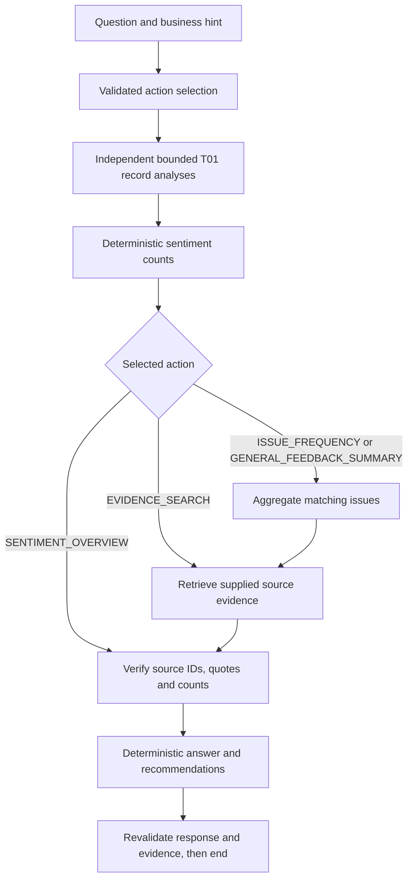

> Historical pre-T09 reviewer package (2 November 2026). For the current PostgreSQL/Gmail/evidence implementation and pending real external MCP client test, use [the final submission audit](../qa/FINAL_SUBMISSION_AUDIT.md). Original evidence below is retained.

# Agentic AI verification — independent provisional audit

The application demonstrates **bounded agentic orchestration**, not merely one
LLM call behind FastAPI. This is verified locally with controlled model responses;
real model intent-selection quality and unconstrained autonomous planning are not
established. One compiled request-local StateGraph coordinates shared services.

## Actual workflow

[build_feedback_graph](../../app/agents/feedback_graph.py#L31) constructs and compiles
LangGraph with explicit conditional edges. [ActionSelector](../../app/agents/action_selector.py#L25)
uses native strict ActionSelection output; question and business-type hint are its
only user payload. Feedback and tool results never enter that selector. Parameters
and action IDs are revalidated before deterministic execution. Four actions are
allowlisted; shell/filesystem/arbitrary URLs are not graph tools.

[InvestigationService](../../app/services/investigation_service.py#L20) invokes the
compiled graph with recursion_limit12 and a configured total deadline; max ten
records sequentially, one selector operation, fail-fast record handling. No cycles,
checkpoint, cross-request memory or self-directed retry/repair agent exists.
Source IDs, exact quotations, filters, category counts and final prose are checked
before/after response construction. Recommendations are tentative suggestions;
no external business facts/actions or historical records are invented by code.

Fresh [four-route test](../../tests/unit/test_langgraph_workflow.py#L17) passes all
four cases. Selector invalid-output/question-only tests, graph timeout/fail-fast
and evidence-tamper tests also pass in [571-case run](test-results.json). The
[additional actual-adapter workflow B](workflow-results.json) observed:

| Action | Observed public tools_used after common analyze/count steps |
| --- | --- |
| SENTIMENT_OVERVIEW | generate_insights |
| ISSUE_FREQUENCY | aggregate_issues, retrieve_evidence, generate_insights |
| EVIDENCE_SEARCH | retrieve_evidence, generate_insights |
| GENERAL_FEEDBACK_SUMMARY | aggregate_issues, retrieve_evidence, generate_insights |

verify_evidence is a real graph node, not included as a public tools_used label.
The provider stub chooses a validated action according to the question; actual
LangGraph then routes accordingly. This proves conditional execution and output
validation, not that a live model chooses the correct action for arbitrary phrasing.

## Mandatory repository comparison

The [required repository](https://github.com/nibzard/awesome-agentic-patterns) and
nine pattern files below were read during this audit. References are mutable main
branch pages, not a pinned commit; no Git command was used. Repository examples
are design references, not requirements to add every illustrated component.

| Pattern and source | Actual implementation / functions | Executed test evidence | Completeness |
| --- | --- | --- | --- |
| [Structured Output Specification](https://github.com/nibzard/awesome-agentic-patterns/blob/main/patterns/structured-output-specification.md) | SentimentService/create_sentiment_service, ActionSelector/create_action_selector and Pydantic schemas; native strict requests plus runtime/evidence validation | test_actual_chatgroq_adapter_strict_schema_with_mock_http; test_invalid_selector_outputs_fail_closed; workflow A/B wire assertions | VERIFIED core application; model semantic truth is separate |
| [Action-Selector](https://github.com/nibzard/awesome-agentic-patterns/blob/main/patterns/action-selector-pattern.md) | ActionSelector.select, graph select_action/route; allowlisted schema output, no feedback/tool-output return to selector | test_all_four_conditional_routes; test_selector_receives_question_and_hint_only; test_poisoned_selector_cannot_request_arbitrary_execution; workflow B | VERIFIED core application; parameter poisoning/model quality not universally solved |
| [Dual-Use Tool Design](https://github.com/nibzard/awesome-agentic-patterns/blob/main/patterns/dual-use-tool-design.md) | REST/MCP call the same T01/T02 implementations and schemas; humans/agents use the same API within each authority boundary | test_real_inprocess_protocol_workflows_g_h; REST reuse tests; workflows A/B/E | VERIFIED shared stateless capability; REST tenant registry and local MCP trusted-launcher authority intentionally differ; no owned lookup parity |
| [LLM Map-Reduce](https://github.com/nibzard/awesome-agentic-patterns/blob/main/patterns/llm-map-reduce-pattern.md) | analyze_record/analyze_feedback_items issue separate constrained per-item calls; ReportingService and aggregate_sentiment/aggregate_issues reduce validated outputs in Python | test_reporting_unique_aspects_and_supporting_ids; test_counts_order_and_unique_supporting_ids; workflow D | VERIFIED application-level independent context/reduction; no OS-isolated worker guarantee |
| [LLM-Friendly API Design](https://github.com/nibzard/awesome-agentic-patterns/blob/main/patterns/llm-friendly-api-design.md) | Versioned thin REST, explicit request/result schemas, descriptive two-tool MCP schemas and fixed actionable errors | test_openapi_inventory_security_and_response_schemas; MCP discovery/schema tests;19 operations and workflow E | VERIFIED core interface application |
| [Output Verification Loop](https://github.com/nibzard/awesome-agentic-patterns/blob/main/patterns/output-verification-loop.md) | SentimentResponse.verify_evidence, verify_findings and ReportingService.build enforce source quotation/metadata/count consistency | test_evidence_verifier_rejects_tampering; test_reporting_rejects_foreign_source_metadata; test_malformed_json_and_invented_evidence | PARTIALLY_VERIFIED catalogue adaptation: deterministic grounding exists; no atomic claim extraction, external evidence retrieval or per-claim trust scores |
| [Multi-Platform Webhook Triggers](https://github.com/nibzard/awesome-agentic-patterns/blob/main/patterns/multi-platform-webhook-triggers.md) | authenticate_webhook, WebhookService.accept/workers implement generic signed external triggers, replay/dedup and temporary status | test_valid_raw_signature_no_rest_key_status_and_duplicate; test_parallel_duplicates_schedule_exactly_one_call; workflow G | PARTIALLY_VERIFIED catalogue adaptation: generic authenticated trigger, no named Slack/Notion/Jira adapters; Gmail is explicit import, not polling/webhook |
| [Tool Capability Compartmentalization](https://github.com/nibzard/awesome-agentic-patterns/blob/main/patterns/tool-capability-compartmentalization.md) | MCP REQUEST_MODELS/register_tools expose only two processors; no private mailbox/file/DB reader or mutating tool | test_mcp_rejects_invalid_arguments_and_unapproved_capabilities; test_mcp_remains_stateless_launcher_authorized_without_tenant_arguments_or_registry_disclosure | PARTIALLY_VERIFIED catalogue adaptation: narrow capability allowlist, no reader/processor/writer zones with separate runtimes/delegation/consent machinery |
| [Hybrid LLM/Code Workflow Coordinator](https://github.com/nibzard/awesome-agentic-patterns/blob/main/patterns/hybrid-llm-code-workflow-coordinator.md) | LLM handles extraction/selection; Python handles OAuth/MIME, policy, lifecycle, aggregation and final prose | graph/report/Gmail tests; workflows B/D/I | Principle only, PARTIALLY_VERIFIED; no configurable switchable LLM/script coordinator. Not counted as ninth full pattern |

Of the eight previously claimed scoped patterns/adaptations: **five core applications
verified, three narrower adaptations**; plus one hybrid principle. No relevant-pattern
requirement gap is demonstrated: the communicated requirement is to use relevant
patterns, not implement the whole catalogue. Existing docs generally qualify these
adaptations; this audit preserves that distinction. Full catalogue mechanisms are
not automatically required enhancements.

## MCP protocol, reuse and capability boundary

[mcp.server.MCPServer](../../app/mcp_server/server.py) comes from official SDK2.3.0,
verified in installed metadata. Exactly analyze_feedback and investigate_feedback
are discoverable. Input/output JSON schemas match SentimentRequest/Response and
InvestigationRequest/Response; no second classifier/graph. Official Client discovery,
invocation and controlled errors pass in both in-process modes. Official stdio
client tests invoke both tools, validate protocol-only stdout, safe stderr and clean
shutdown; the real unconfigured server fails safely instead of calling a provider.

This is real protocol verification with mocked inference, not an import-only
claim. Local MCP is launcher-authorized stateless analysis; it provides no tenant
argument, owned batch/Gmail lookup, credential registry or remote HTTP transport.
Additional reporting tools are not an established reviewer requirement. Existing
investigation output already contains counts, issue summaries and evidence; REST
provides the batch JSON reports/downloads.

## Quality limits

The single historical T01 live request is separately recorded, and its response
revalidates against the current Pydantic/exact-evidence rules. No new inference,
Google request, labeled accuracy evaluation or adversarial-model robustness study
was performed. Mock outcomes demonstrate deterministic integration correctness;
they do not prove semantic classification, selector accuracy or arbitrary-summary
truth. Urgency/recommendations are model suggestions, not verified safety decisions.
