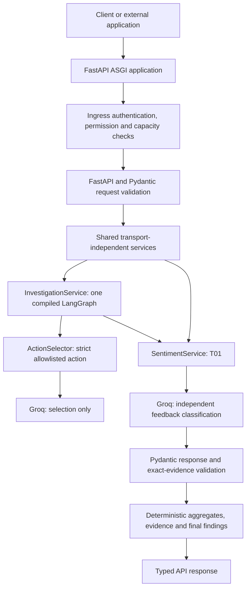
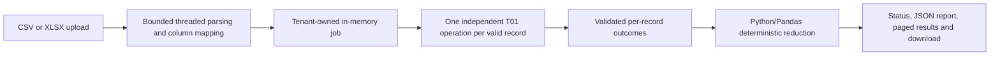
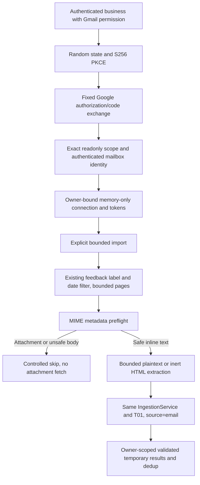

> Historical pre-T09 reviewer package (2 November 2026). For the current PostgreSQL/Gmail/evidence implementation and pending real external MCP client test, use [the final submission audit](../qa/FINAL_SUBMISSION_AUDIT.md). Original evidence below is retained.

# Architecture walkthrough

This explains the actual T01–T08 implementation. It does not add a graph,
classifier, database, frontend or deployment component. The API-only scope and
original-reviewer compliance assessment remain provisional.

## REST entry and shared analysis

The ASGI ingress guard wraps route processing: REST authentication/permission and
admission occur before body consumption, then bounded original bytes are replayed
to FastAPI. Health is public liveness. Webhooks use separate original-byte HMAC;
OAuth callback uses expiring state instead of an API-key header. Actual policies
are in [ingress_limits.py](../../app/core/ingress_limits.py),
[tenant_auth.py](../../app/core/tenant_auth.py),
[webhook_security.py](../../app/core/webhook_security.py) and thin
[versioned routes](../../app/api/v1).

[main.py](../../app/main.py) creates/owns REST HTTP clients, one sentiment instance,
one investigation instance and the ingestion/batch/webhook/Gmail services during
lifespan. Cleanup cancels work and clears temporary state. Direct sentiment does
not need a graph. Chat is a light explicit-mode coordinator over T01/T02; it adds
no formatting model call or conversation memory.

## Classification versus agentic investigation

T01 serializes one feedback text as untrusted data alongside system instructions,
requests native strict JSON schema from configured Groq, then revalidates with the
original text as evidence context. No free-form/best-effort successful fallback.
The source/business-type labels are allowed hints, never authentication context.

The graph's selector receives only question and business hint; strict output must
name SENTIMENT_OVERVIEW, ISSUE_FREQUENCY, EVIDENCE_SEARCH or GENERAL_FEEDBACK_SUMMARY
with validated filters/limits. The graph analyzes at most ten records sequentially,
then takes the appropriate conditional issue/evidence path. Python recomputes
source membership, quotations, counts and final prose before return. Total deadline,
recursion_limit12, acyclic edges and no checkpoint bound execution.

Dynamic validated action selection and conditional tool execution make this a
bounded agentic investigation. It is not open-ended autonomy. Mocked selector
responses prove branch behavior; arbitrary natural-language selection quality is
not established by those tests. [feedback_graph.py](../../app/agents/feedback_graph.py),
[investigation_service.py](../../app/services/investigation_service.py),
[evidence.py](../../app/tools/evidence.py).

## File map-reduce and temporary owned jobs

Parsing rejects invalid formats/IDs/mappings and applies2MiB/100-record/5,000-character
bounds. It runs off the event loop with admission held until actual parse completion,
including cancelled requests. Each admitted job has bounded in-process execution;
existing two batch model permits and shared REST/tenant admission restrict calls.
Invalid rows and controlled provider failures are explicit outcomes; fatal
configuration/authentication errors stop further batch calls.

Python calculates distributions/rounding, issue frequencies, unique-record aspect
counts and source-linked evidence. It does not ask an LLM to calculate totals or
invent missing dates. Raw mapped text clears as rows finish; derived terminal
reports/results expire after30minutes. Authenticated owners can read their jobs;
foreign and unknown IDs both404. No queue framework/database. See
[batch_service.py](../../app/services/batch_service.py),
[file_parser.py](../../app/services/file_parser.py),
[reporting_service.py](../../app/services/reporting_service.py),
[job_store.py](../../app/storage/job_store.py).

## MCP is another interface to the same implementations

A trusted local launcher starts the official MCPServer via stdio. Official clients
discover analyze_feedback/investigate_feedback, submit typed arguments and receive
structured SentimentResponse/InvestigationResponse or safe tool errors. Those tools
delegate to T01/T02. The separate MCP process owns its own HTTP clients/service
instances and two-active-tool admission; it does not share REST memory/counters
across processes. Stdout contains protocol messages only.

There is no remote MCP HTTP, tenant argument, mailbox/credential registry, batch
lookup, filesystem/shell or mutating tool. Local launcher authority is not a REST
business API key. [server.py](../../app/mcp_server/server.py),
[tools.py](../../app/mcp_server/tools.py).

## Signed webhook and direct ingestion

Direct POST /ingest/feedback authenticates a business and normalizes allowed text/
channel/source fields into the existing T01 instance. Signed webhook intake verifies
HMAC-SHA256 over integration.timestamp.delivery.original_body, timestamp window
and configured integration identity before JSON parsing. It does not reserialize
the signed bytes. Atomic tenant+delivery reservation additionally records integration
and a timestamp-independent body digest. Identical authenticated retries deduplicate;
changed bytes or same-tenant cross-integration collision reject.

Two fixed workers and a20-event pending bound feed the same IngestionService/T01.
Owner scheduling skips saturated tenants; a60-second deadline bounds processing.
Status exposes lifecycle/safe codes, not analysis/body. Terminal metadata TTL30minutes;
raw feedback drops after work/shutdown. This is a generic trigger, not a named
commercial connector or durable/exactly-once delivery system.
[webhook_service.py](../../app/services/webhook_service.py).

## Tenant authority and quotas

Private bounded credential/integration registries issue immutable Principals whose
proof, tenant, credential and permissions are revalidated at sensitive boundaries.
No request field, CSV metadata, business_type or model result selects tenant identity.
Jobs capture the authenticated owner; workers bind it explicitly. Reports/downloads/
events/Gmail results authorize in services/stores as well as routes. Rotation keys
share tenant ownership/quotas. Legacy development credentials cannot act as business
superusers and are disabled in production.

Global controls remain:4MiB actual JSON bytes, separate16KiB webhook and2MiB upload
caps,16 active requests,120 admissions/minute,15-second body deadline and four shared
REST model operations by default. Per-business request/rate/model/investigation/job/
webhook quotas leave global headroom. Limits and stores are single-process, not
host-wide or distributed guarantees. [processing_limits.py](../../app/core/processing_limits.py),
[tenant guide](../TENANT_ISOLATION.md).

## Gmail-to-sentiment path

OAuth callback authority is one-use expiring owner-bound state, not an API-key
header or query tenant/mailbox claim. Google getProfile supplies mailbox identity;
one mailbox cannot silently transfer to another tenant. State/connection/job/dedup
capacity is bounded. Access refresh is serialized per connection; failure/expiry
requires reconnect safely. Tokens stay private RAM; disconnect invalidates in-flight
flows, clears owner state and cancels owner work, without revoking Google's grant.

Imports use default customer-feedback label/newer_than:7d,20 messages/five pages,
16KiB/5,000-character text, two global/one tenant imports and120-second job deadline.
No polling/sending/deleting/label mutation/attachment retrieval. Only selected body
text goes to Groq; subject/sender/time are transient. Derived evidence can quote
sensitive text and is TTL-limited. Google behavior is mock verified only.
[Gmail guide](../GMAIL_INTEGRATION.md).

## Deterministic and model responsibilities

| Model operations | Deterministic Python operations |
| --- | --- |
| Sentiment/aspect/primary-category/urgency/summary/next-step extraction | Authentication, permissions, ownership and resource admission |
| Allowlisted question-to-action interpretation | Graph transitions, timeouts/retries, schemas and source quotations |
| No other model stage | OAuth/HMAC, selection/MIME, deduplication, job lifecycle/cleanup |
| No model arithmetic/report formatter | Counts, filtering, percentages, aspect grouping, verified final report prose |

Schema correctness and exact-evidence/count checks do not prove every summary
sentence or classification true. There is no per-claim external fact checker or
measured model accuracy. [Pattern scope](AGENTIC_AI_VERIFICATION.md).

## Verification and operating limits

The final submission suite passes571 cases, including official stdio MCP and124
Gmail cases; nine full offline scenarios and loopback startup checks pass.
[Fresh evidence](submission-workflows.json), [startup](submission-startup.json),
[tests](submission-pytest.xml). The single historical Groq smoke remains separate;
no new live providers were called. Restart loses all process-local state/ownership,
and production encrypted OAuth persistence/deployment are outside this submission.
